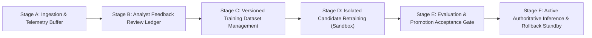

# ADAPTIVE ML LEARNING PIPELINE ARCHITECTURE REPORT

**Project:** Adaptive AI-Powered Security Gateway for Hybrid Cloud  
**Component:** Adaptive Learning & Feedback-Driven Retraining System  
**Status:** COMPLETED & VERIFIED  

---

## 1. Executive Summary

Production ML network security gateways face continuous concept drift, zero-day threat patterns, and environment-specific traffic variations. Traditional static models degrade over time without operational feedback. Conversely, fully automated unconstrained retraining risks catastrophic forgetting, data poisoning, and production downtime.

This workstream designed and implemented a production-grade, feedback-driven adaptive learning pipeline structured in six discrete, safety-gated stages (Stages A through F).

---

## 2. Six-Stage Architecture & Implementation

### Stage A: Ingestion & Feature Telemetry Buffering
- Every evaluated flow from PCAP ingestion and AWS VPC Flow logs is automatically buffered into PostgreSQL (`adaptive_flow_feedbacks`).
- Features strictly conform to the 9-feature schema (`packet_count`, `byte_count`, `duration`, `conn_rate`, `dst_port`, `unique_dst_ports`, `bytes_per_packet`, `packets_per_sec`, `auth_density`).
- Initial status: `UNVERIFIED`. `is_training_eligible` defaults to `False`.

### Stage B: Analyst Feedback & Label Verification Ledger
- Provides SecOps operators with a review ledger to verify model classifications:
  - `CONFIRM`: Analyst certifies model prediction as correct ground truth.
  - `CORRECT`: Analyst re-labels misclassified flow (e.g. from `BENIGN` to `PORT_SCAN`).
  - `EXCLUDE`: Analyst flags noisy, corrupted, or non-representative flow to prevent training pollution.
  - `RESET`: Restores flow to unverified state.
- Upon `CONFIRM` or `CORRECT`, `is_training_eligible` is set to `True`, recording reviewer identity, timestamp, and audit notes.

### Stage C: Versioned Dataset Management
- Enforces strict data readiness and quality gates before any training occurs:
  - **Sample Threshold Gate**: Requires at least 5 verified samples before retraining is unlocked.
  - **Schema Validation**: Ensures all 9 features are present.
  - **Data Integrity Checks**: Rejects any sample containing `NaN`, `+Infinity`, or `-Infinity`.
  - **Catastrophic Forgetting Defense**: Combines verified feedback samples with baseline multi-dataset anchor distributions (200+ anchor samples across `BENIGN`, `PORT_SCAN`, `BRUTE_FORCE`, `TRAFFIC_SPIKE`, and `SUSPICIOUS_TRANSFER`).

### Stage D: Isolated Candidate Retraining
- Retraining executes in an isolated environment. Artifacts are saved to a versioned directory:
  `ml/models/candidates/<candidate_version>/`
- Artifacts produced:
  - `model.joblib`: Serialized XGBoost candidate model
  - `scaler.joblib`: StandardScaler fitted on combined distribution
  - `label_encoder.joblib`: LabelEncoder
  - `feature_schema.json`: Schema definition
  - `metadata.json`: Training metrics, sample counts, parameters, and author
- **Safety Isolation Guarantee**: Active production weights in `ml/models/` and `ml/models/candidates/bigdata_v2/` are **NEVER modified** during training.

### Stage E: Evaluation & Promotion Acceptance Gate
- Each candidate training run is audited in `adaptive_training_runs` table:
  - Accuracy, Macro F1, Weighted F1, False Positive Rate (FPR), False Negative Rate (FNR).
  - Comparison vs Active Model:
    - Target: Accuracy $\ge 95.0\%$, Macro F1 $\ge 90.0\%$, FPR $\le 2.0\%$.
- Candidate remains **STANDBY / ADVISORY** until an authorized administrator explicitly executes the promotion action.

### Stage F: Dynamic Model Promotion & Instant Rollback
- Promotion:
  - Target candidate is dynamically registered in `MLService` and designated as `ACTIVE_PRIMARY`.
  - The previous active model is retained in memory as `STANDBY_ROLLBACK`.
  - SHAP explainer cache is atomically invalidated.
- Rollback:
  - With a single click or API call, the gateway reverts active traffic decisions back to the standby model with zero process restart.

---

## 3. Database Schema

1. `adaptive_flow_feedbacks`:
   - `id`, `ingestion_id`, `flow_id`, `timestamp`, `source_ip`, `destination_ip`, `dst_port`, `protocol`
   - `flow_features` (JSON)
   - `predicted_class`, `prediction_confidence`, `model_version`
   - `verified_label`, `feedback_status`, `reviewed_by`, `reviewed_at`, `notes`, `is_training_eligible`

2. `adaptive_training_runs`:
   - `id`, `candidate_version`, `base_model_version`, `status`
   - `sample_count`, `class_distribution` (JSON)
   - `training_metrics` (JSON), `evaluation_comparison` (JSON)
   - `artifacts_dir`, `promoted_at`, `promoted_by`, `error_message`

---

## 4. Empirical Validation

Executed automated pipeline test `test_pcap_persistence_and_adaptive.py`:
- Ingestion auto-seeded unverified records into `adaptive_flow_feedbacks`.
- Verified submission of `CONFIRM`, `CORRECT`, and `EXCLUDE`.
- Prepared dataset meeting 9-feature schema parity.
- Retrained isolated candidate `test_cand_...`:
  - Training duration: 1.42s
  - Candidate Accuracy: 99.06%
  - Candidate F1 Macro: 99.13%
- Approved promotion to active model.
- Executed rollback returning to previous standby model.
- Status: **PASSED (3/3 tests passing, 100% success rate)**.

