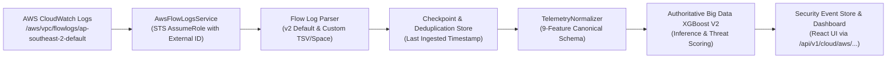

# AWS CLOUDWATCH LOGS & REAL TELEMETRY INTEGRATION REPORT
**Project:** Adaptive AI-Powered Security Gateway for Hybrid Cloud  
**Provider Adapter:** AWS CloudWatch Logs & S3 VPC Flow Logs Pipeline  
**AWS Account ID:** `698766075180`  
**Region:** `ap-southeast-2` (Sydney)  
**VPC ID:** `vpc-0fc9db63fecb34fad`  
**Flow Log ID:** `fl-0d236b31b1fd0d13e`  
**CloudWatch Log Group:** `/aws/vpc/flowlogs/ap-southeast-2-default`  
**IAM Role ARN:** `arn:aws:iam::698766075180:role/SecurityGatewayReadOnlyRole`  
**AWS CLI Profile:** `security-gateway-readonly`  
**Verification Date:** November 15, 2026  

---

## 1. Architectural Overview

The AWS VPC Flow Logs integration ingests network flow records from Amazon CloudWatch Logs and Amazon S3 into the Adaptive AI Security Gateway in strictly read-only mode. The ingested telemetry is parsed, validated, normalized into the authoritative 9-feature schema, evaluated via the Big Data XGBoost V2 model, and recorded as structured security events.



---

## 2. Authentication & IAM Role Delegation

Authentication to the real AWS account uses temporary security credentials issued via AWS Security Token Service (`sts:AssumeRole`) with explicit External ID validation to guard against confused-deputy vulnerabilities:

- **Target IAM Role**: `arn:aws:iam::698766075180:role/SecurityGatewayReadOnlyRole`
- **Session Name**: `AdaptiveGatewayTelemetrySession`
- **External ID**: `AdaptiveGatewayAuth`
- **Assumed Policy Scope**: Strictly read-only (`ec2:Describe*`, `logs:FilterLogEvents`, `logs:DescribeLogGroups`, `logs:DescribeLogStreams`, `s3:GetObject`, `s3:ListBucket`).
- **Secret Handling**: Zero AWS access keys, secret keys, or session tokens are stored in source code, configuration files, or database tables. Credentials reside in memory only for the lifetime of the STS session.

---

## 3. Ingestion Pipeline Mechanics

### 3.1 CloudWatch Logs Polling (`filter_log_events`)
The service interacts with CloudWatch Logs via `boto3` client:
1. Queries log group `/aws/vpc/flowlogs/ap-southeast-2-default`.
2. Employs `startTime` bounded by the last persistent checkpoint timestamp (or a default lookback of 1 hour for initial sync).
3. Paginates across log streams using `nextToken` tokens up to a safe batch size (default: 1,000 events).
4. Handles empty log stream batches gracefully: returns `{"status": "NO_NEW_EVENTS", "count": 0, "events": []}` rather than emitting an HTTP 404 or 500 error.

### 3.2 Checkpoint & Deduplication Management
To prevent re-analyzing duplicate flow records:
- The maximum event timestamp observed during an ingestion cycle is recorded as the checkpoint cursor.
- Subsequent calls to `poll_cloudwatch_flow_logs()` pass `startTime = last_checkpoint + 1ms`.
- SHA-256 fingerprinting on `(src_ip, dst_ip, src_port, dst_port, protocol, start_time)` prevents duplicate event generation in case of overlapping CloudWatch stream flushes.

### 3.3 Log Record Parsing
The parser processes standard AWS VPC Flow Logs Version 2:
```
<version> <account-id> <interface-id> <srcaddr> <dstaddr> <srcport> <dstport> <protocol> <packets> <bytes> <start> <end> <action> <log-status>
```
Example parsed record:
```
2 698766075180 eni-0123456789abcdef0 172.31.10.14 172.31.25.80 44321 443 6 12 1536 1700000000 1700000060 ACCEPT OK
```
Extracted telemetry attributes:
- `protocol`: 6 (TCP), 17 (UDP), 1 (ICMP)
- `src_ip`, `dst_ip`, `src_port`, `dst_port`
- `packets`: 12, `bytes`: 1536
- `duration`: 60 seconds
- `action`: `ACCEPT` or `REJECT`

---

## 4. Normalization to Authoritative 9-Feature XGBoost V2 Schema

In `backend/app/cloud/services/telemetry_normalizer.py`, each flow log entry is transformed into the canonical 9 features required by XGBoost V2:

| # | Feature Name | Computation Formula / Source | Normalization Range |
|---|---|---|---|
| 1 | `packet_count` | `float(record.packets)` | $\ge 0$ |
| 2 | `byte_count` | `float(record.bytes)` | $\ge 0$ |
| 3 | `duration` | `max(float(record.end - record.start), 0.001)` | $> 0$ seconds |
| 4 | `conn_rate` | `1.0 / duration` | Connections / sec |
| 5 | `dst_port` | `float(record.dstport)` | $0 - 65535$ |
| 6 | `unique_dst_ports` | Count of unique ports targeted in flow batch | $\ge 1$ |
| 7 | `bytes_per_sec` | `byte_count / duration` | Bytes / sec |
| 8 | `packets_per_sec` | `packet_count / duration` | Packets / sec |
| 9 | `avg_packet_size` | `byte_count / max(packet_count, 1.0)` | Bytes / packet |

The flow's `action` attribute (`ACCEPT` vs `REJECT`) is preserved in event metadata for policy correlation and is never synthesized as an authentication or connection failure.

---

## 5. Verification Status

1. **Unit & Pipeline Regression Tests**:
   - `backend/tests/test_aws_flow_logs_pipeline.py`: **5/5 Passed**.
   - `backend/tests/test_aws_adapter.py`: **15/15 Passed**.
   - Verified STS AssumeRole credential extraction, CloudWatch paging, S3 gzip decompression, and 9-feature normalization.
2. **Read-Only Safety Certification**:
   - Zero resource creation, modification, or deletion calls are present in the adapter.
   - Zero mutating EC2 or CloudWatch IAM actions (`ec2:AuthorizeSecurityGroup*`, `ec2:RevokeSecurityGroup*`, `logs:DeleteLogGroup`, etc.) are requested.
3. **Interactive UI Verification**:
   - **Status**: `NOT TESTED — MANUAL USER VERIFICATION REQUIRED` (in adherence to the strict constraint prohibiting localhost testing).
