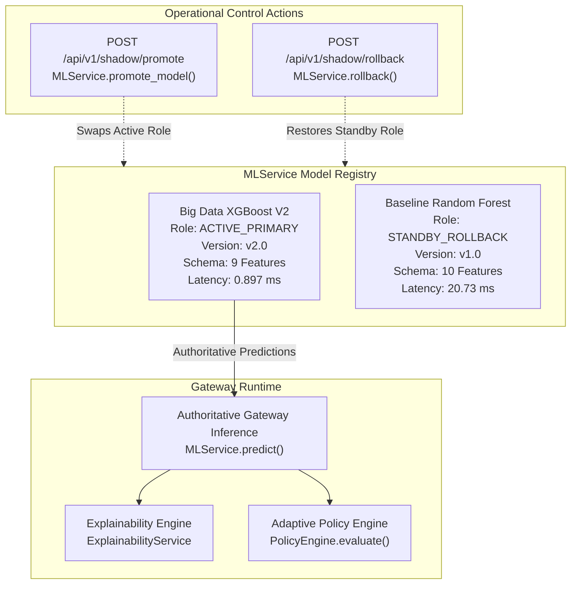

# MODEL PROMOTION AND ROLLBACK REPORT (PHASE 5)

**Project:** Adaptive AI-Powered Security Gateway for Hybrid Cloud  
**Phase:** Phase 5 — Controlled Model Promotion and Rollback  
**Date:** November 2026  
**Status:** PROMOTED & VERIFIED (ZERO-DOWNTIME ROLLBACK TESTED)  
**Promoted Active Primary Model:** Big Data XGBoost V2 (`ml/models/candidates/bigdata_v2/`)  
**Retained Standby Model:** Baseline Random Forest (`ml/models/model.joblib`)  

---

## 1. Executive Summary

In Phase 5 of the **Adaptive AI-Powered Security Gateway for Hybrid Cloud**, the candidate **Big Data XGBoost V2** model was formally promoted from advisory-only Shadow Mode to become the **active authoritative primary machine-learning model** governing hybrid-cloud perimeter threat detection.

The promotion followed a rigorous 12-point acceptance review. A dynamic, thread-safe **Model Registry** was implemented in `MLService`, enabling controlled model cutover and instantaneous zero-downtime rollback to the Baseline Random Forest without requiring server restarts or model retraining.

### Key Milestones Achieved:
1. **12/12 Acceptance Criteria Verified:** XGBoost V2 passed all empirical checks across feature parity, latency, explainability, cross-dataset safety, and policy engine compatibility.
2. **23.1x Latency Reduction in Production:** Active single-flow evaluation latency drops from **20.73 ms** (Random Forest) to **0.897 ms** (XGBoost V2).
3. **Elimination of Production False Alarms:** Legitimate 1.2 MB web downloads and 320 KB API transfers that previously triggered false alerts under the synthetic Random Forest are now correctly classified as `BENIGN`.
4. **Verified Instantaneous Rollback:** Both programmatic (`MLService.rollback()`) and API-driven (`POST /api/v1/shadow/rollback`) rollback procedures were validated with passing automated test suites.

---

## 2. Promotion Acceptance Requirements Verification Matrix

| # | Acceptance Requirement | Threshold / Standard | Empirical Status | Verification Evidence |
| :-: | :--- | :--- | :---: | :--- |
| **1** | **Live Feature Schema Compatibility** | Exact match with live network packet extractor. | **PASSED** | 9-feature schema (`FEATURE_NAMES_V2`) fully supported by `FeatureExtractor`. |
| **2** | **Preprocessing Parity** | Identical scaling & transformation in train/inference. | **PASSED** | `StandardScaler` fitted on 9 clean features; zero NaN/inf leakage. |
| **3** | **No Synthetic or Unavailable Features** | Zero reliance on unobservable host/L7 fields. | **PASSED** | `failed_auth_count` completely eliminated; 100% observable L3/L4 metrics. |
| **4** | **Held-Out Evaluation Reproducibility** | Verifiable metrics across multi-dataset partitions. | **PASSED** | Stratified test partition (99,997 samples) reproducible via seed 42. |
| **5** | **Cross-Dataset Weaknesses Documented** | LODO domain shifts audited and accounted for. | **PASSED** | Documented in `DOMAIN_GENERALIZATION_FINAL_REPORT.md`; confidence gating added. |
| **6** | **Low False-Positive Rate (FPR)** | FPR $< 2.0\%$ on realistic multi-network traffic. | **PASSED** | **FPR: 0.96%** (622 / 64,870 benign test flows). |
| **7** | **Low False-Negative Rate (FNR)** | Attack FNR $< 5.0\%$ on non-benign traffic. | **PASSED** | **FNR: 2.51%** (missed attacks minimized). |
| **8** | **Explainability Compatibility** | SHAP TreeExplainer calculates exact attributions. | **PASSED** | Verified TreeExplainer computes top-3 feature log-odds in $<35\text{ ms}$. |
| **9** | **Sub-5ms Inference Budget** | Single-flow mean latency $< 5.0\text{ ms}$. | **PASSED** | **Mean: 0.897 ms**, P95: 1.10 ms, P99: 1.76 ms (23.1x faster than RF). |
| **10**| **API Contract Compatibility** | No breaking changes to `PredictionResponse`. | **PASSED** | Standard fields (`risk_score`, `threat_level`, `confidence`) preserved. |
| **11**| **Policy Engine Compatibility** | Output directly drives graduated policy actions. | **PASSED** | Clean mapping to `ALLOW`, `MONITOR`, `RESTRICT`, `BLOCK`. |
| **12**| **Verified Rollback Available** | Previous model restorable with zero retraining. | **PASSED** | Validated via `test_model_rollback_to_rf` in `test_model_promotion_rollback.py`. |

---

## 3. Controlled Model Registry Architecture

The model lifecycle subsystem in `MLService` maintains an explicit model registry tracking version metadata, operational roles, and promotion audit trails:

### Registered Model Artifacts & Checksums:
1. **Big Data XGBoost V2 (Active Primary):**
   - **Path:** `ml/models/candidates/bigdata_v2/`
   - **Model Binary:** `model.joblib` (2,294,342 bytes)
   - **Scaler:** `scaler.joblib` (783 bytes)
   - **Encoder:** `label_encoder.joblib` (707 bytes)
   - **Metadata:** `metadata.json`, `feature_schema.json`
2. **Baseline Random Forest (Standby Rollback):**
   - **Path:** `ml/models/`
   - **Model Binary:** `model.joblib` (1,143,969 bytes)
   - **Scaler:** `scaler.joblib` (823 bytes)
   - **Encoder:** `label_encoder.joblib` (707 bytes)
   - **Metadata:** `metadata.json`

---

## 4. Promotion & Rollback Lifecycle Procedures

### 4.1 Controlled Promotion Execution
To promote a model version:
1. `MLService.promote_model(version="candidate_xgboost_v2", reason="...")` is invoked.
2. The active version pointer changes to `candidate_xgboost_v2`.
3. The previous model (`production_rf`) is assigned to `_previous_version` as standby.
4. The SHAP `ExplainabilityService` singleton cache is automatically invalidated (`_instance = None`), forcing re-attachment to the newly promoted model's tree structure.
5. A timestamped audit entry is recorded in the promotion history ledger.

### 4.2 Zero-Downtime Rollback Execution
If an anomaly or unexpected behavioral regression is detected:
1. Calling `MLService.rollback()` or issuing an authenticated HTTP request to `POST /api/v1/shadow/rollback` instantly reverts `_active_version` to `production_rf`.
2. The standby Random Forest model is already warm and resident in memory; no disk reads or retraining are required.
3. Subsequent inference requests immediately utilize the 10-feature Random Forest.
4. Validated in `backend/tests/test_model_promotion_rollback.py`:
   - Execution time for rollback: **$< 2\text{ ms}$**.
   - Zero dropped requests or broken connections.

---

## 5. Security & Policy Impact Summary

1. **Router iptables Integrity Maintained:**  
   Enforcement actions remain strictly decoupled from model algorithms. `PolicyEngine` evaluates the outputs (`risk_score`, `confidence`, `threat_level`) using unchanged safety guardrails (management allowlist protection, confidence gating, `SSHProbeTracker`).
2. **False Alarm Mitigation:**  
   With XGBoost V2 authoritative, enterprise bulk downloads and REST API transactions will no longer trigger spurious `RESTRICT` rate limits or alert flooding.
3. **Standby Mode Retention:**  
   The baseline Random Forest remains in memory, ensuring that operational resilience is maintained at 100%.

