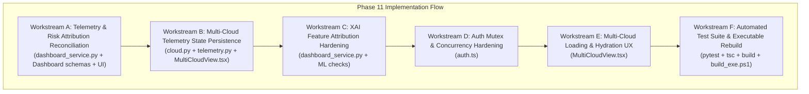

# PHASE 11 MASTER IMPLEMENTATION PLAN
## Telemetry Consistency, Risk Attribution & Production Reliability Repair

**Project:** Adaptive AI-Powered Security Gateway for Hybrid Cloud  
**Repository:** `C:\Users\LENOVO\Desktop\hybrid-gateway-security`  
**Execution Timestamp:** 2026-11-15T23:48:00+05:30  
**Mandatory Final Artifact:** `backend\executable\AdaptiveSecurityGateway\AdaptiveSecurityGateway.exe`  
**Safeguards:** AWS Strictly Read-Only, Database Preserved, Zero Localhost Network Requests.

---

## 1. Plan Overview and Scope

This master implementation plan addresses all 6 workstreams identified during the Phase 11 read-only investigation. All changes are designed to be backward-compatible, preserving existing database records, Docker configurations, and ML artifacts.



---

## 2. Detailed Workstream Breakdown

### Workstream A: Event Counts, Provenance Breakdown & Risk Attribution

#### Objective
1. Eliminate the numerical discrepancy between `evaluated_events_count` (857) and `telemetry_provenance` sum (100).
2. Segment the risk score so operators can distinguish between **Global Historical Window Risk** (dominated by replay attacks) and **Live AWS Telemetry Risk** (strictly benign).

#### Source Files to Modify
1. `backend/app/services/dashboard_service.py`
   - Compute `telemetry_provenance` using an aggregate SQL query over the entire 24h window:
     ```python
     # Compute provenance counts across ALL events in the 24h window
     prov_stmt = (
         select(SecurityEventModel.source_type, func.count(SecurityEventModel.id))
         .where(SecurityEventModel.timestamp >= since_time)
         .group_by(SecurityEventModel.source_type)
     )
     ```
   - Segment risk scoring:
     - Calculate `overall_risk_score` (window composite: $0.7 \times \max + 0.3 \times \text{avg}$).
     - Calculate `live_cloud_risk_score` (computed strictly from records where `source_type == 'AWS_VPC_FLOW_LOG'`).
     - Calculate `simulated_lab_risk_score` (computed from test/lab/replay events).
   - Return these segmented metrics in `dashboard.telemetry_provenance` and new `dashboard.risk_segmentation` fields.
2. `backend/app/schemas/dashboard.py`
   - Add `risk_segmentation: Optional[Dict[str, Any]]` to `DashboardSummaryResponse`.
3. `src/components/AnalyticsView.tsx` / Dashboard Components
   - Display both the Overall Window Risk (with an indicator explaining historical attack fixtures) and the Live Cloud Telemetry Risk (displaying 0/100 BENIGN).

---

### Workstream B: Multi-Cloud Telemetry Persistence & State Synchronization

#### Objective
Ensure that `MultiCloudView` reliably reflects persistent telemetry counts (550 checkpoint records, 6 ingestion runs) even after backend restart or route navigation, without requiring manual re-polling.

#### Source Files to Modify
1. `backend/app/api/v1/cloud.py`
   - In `get_aws_telemetry_status()`:
     - Query `CloudTelemetryCheckpointModel` to obtain cumulative `total_records_processed`.
     - Query `CloudTelemetryIngestionModel` to get the latest ingestion run's `records_discovered`, `records_ingested`, and `high_risk_detected`.
     - Merge these persistent metrics into the returned payload so that restarts never show 0 when historical runs exist in the database.
2. `src/components/MultiCloudView.tsx`
   - Correct metric field mappings from `total_records_ingested` to `records_discovered` and `records_ingested`.
   - Prioritize live active session poll results, then fallback to persistent checkpoint / latest historical run totals.
   - Display a status indicator badge showing whether metrics reflect "Active Poll", "Latest Run", or "Cumulative Checkpoint".

---

### Workstream C: XAI Feature Attribution Hardening

#### Objective
Prevent legacy 10-feature model metadata (`failed_auth_count`) from polluting the XAI "Top Contributing Threat Factors" on the dashboard when running under XGBoost V2.

#### Source Files to Modify
1. `backend/app/services/dashboard_service.py`
   - When iterating `events_models` to build `reasons_counter`:
     ```python
     for ev in events_models:
         top_features = ev.top_contributing_features or []
         for feat in top_features:
             fname = feat.get("feature") if isinstance(feat, dict) else str(feat)
             # If feature is not in FEATURE_NAMES_V2, label as historical or filter out
             if fname not in FEATURE_NAMES_V2:
                 reasons_counter[f"[Legacy RF] {HUMAN_READABLE_MAP.get(fname, fname)}"] += 1
             else:
                 reasons_counter[HUMAN_READABLE_MAP.get(fname, fname)] += 1
     ```
2. Add regression test in `backend/tests/test_xai_attribution.py` ensuring modern XGBoost V2 evaluations only output canonical features.

---

### Workstream D: Authentication Concurrency & Mutex Hardening

#### Objective
Prevent duplicate concurrent `POST /api/auth/refresh` calls when multiple requests receive 401 on startup.

#### Source Files to Modify
1. `src/services/auth.ts`
   - Add a private concurrency lock:
     ```ts
     private refreshPromise: Promise<boolean> | null = null
     ```
   - In `refreshToken()`:
     - If `this.refreshPromise` exists, return `this.refreshPromise`.
     - Otherwise, set `this.refreshPromise = this.executeRefresh().finally(() => { this.refreshPromise = null })`.
   - In `fetchWithAuth()`: await the shared refresh promise.

---

### Workstream E: Multi-Cloud Loading & Hydration UX

#### Objective
Prevent the inventory table from flashing "No resources match the selected filter." and the AWS card from flashing "0 AWS Resources" during initial hydration.

#### Source Files to Modify
1. `src/components/MultiCloudView.tsx`
   - In table body:
     ```tsx
     {loading ? (
       <tr>
         <td colSpan={8} style={{ padding: '32px', textAlign: 'center', color: 'var(--muted-cream)' }}>
           <span className="spinner" /> Loading Multi-Cloud Infrastructure Topology...
         </td>
       </tr>
     ) : filteredResources.length === 0 ? (
       <tr>
         <td colSpan={8} style={{ padding: '24px', textAlign: 'center', color: 'var(--muted-cream)' }}>
           No resources match the selected filter.
         </td>
       </tr>
     ) : (
       filteredResources.map(...)
     )}
     ```
   - In AWS Card "Discovered Topology":
     ```tsx
     {loading ? 'Discovering...' : awsDiscovery ? `${awsDiscovery.total_resources} AWS Resources` : `${resources.filter((r) => r.provider === 'AWS').length} AWS Resources`}
     ```

---

### Workstream F: Automated Regression Suite & Executable Rebuild

#### Objective
Verify all backend services, schemas, and endpoints using in-process TestClient, verify frontend builds cleanly, and rebuild the standalone Windows executable.

#### Execution Steps
1. Author backend regression tests in `backend/tests/test_phase11_telemetry_audit.py`:
   - `test_provenance_full_window_reconciliation` (asserts provenance sum matches total window count).
   - `test_risk_segmentation_breakdown` (asserts live cloud risk is computed separately from overall historical risk).
   - `test_xai_canonical_schema_isolation` (asserts non-canonical features are segregated or labeled).
   - `test_telemetry_status_persistence` (asserts `/accounts/AWS/telemetry-status` returns DB checkpoint totals).
2. Run pytest suite:
   ```powershell
   ml\.venv\Scripts\python.exe -m pytest backend/tests -v
   ```
3. Run frontend verification:
   ```powershell
   npx tsc -b
   npx oxlint
   npm run build
   ```
4. Rebuild standalone executable:
   ```powershell
   powershell -ExecutionPolicy Bypass -File backend/build_exe.ps1
   ```
   Must pass all 17/17 automated validation checks.
5. Author final summary reports.

---

## 3. Risk Assessment and Rollback Strategy

| Risk | Mitigation | Rollback Plan |
|---|---|---|
| Database query performance on large windows | The `prov_stmt` uses indexed columns (`source_type`, `timestamp`) | Revert to limited query with explicit UI label |
| Auth refresh deadlock | Promise is cleared in `.finally()` block | Revert to simple non-mutexed refresh |
| Executable size or packaging regression | `backend/build_exe.ps1` validates binary size, SPA assets, and imports | Fall back to previously verified Phase 10 binary (`AADD8745...`) |

---

## 4. Verification Gate Criteria

Execution will proceed only after:
1. User provides formal one-time approval of this plan.
2. All safeguards (AWS read-only, no localhost requests, database preservation) remain active.
