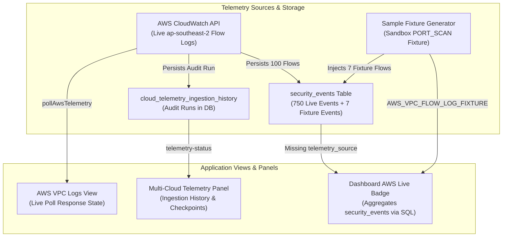

# PHASE 12 — AWS LIVE RISK ATTRIBUTION INTEGRITY AUDIT REPORT

**Project:** Adaptive AI-Powered Security Gateway for Hybrid Cloud  
**Repository:** `C:\Users\LENOVO\Desktop\hybrid-gateway-security`  
**Execution Timestamp:** 2026-11-16T00:43:00+05:30  
**Audit Mode:** STRICT READ-ONLY AUDIT (Zero code, model, database, or configuration modifications)  
**Deliverable:** Root Cause Investigation, Mathematical Reconciliation, Interface Comparison & Recommended Minimal Correction

---

## 1. Executive Summary

This read-only audit conclusively identifies why the Main Dashboard reported an **AWS Live Telemetry risk score of 73/100 (RESTRICT)** while the dedicated **AWS VPC Logs** page reported **100 CloudWatch records parsed into 100 flows, all BENIGN, visible risk scores of 0–1, Allow policy actions, and 0 high-risk flows**.

| Item | Observed Value | True State / Root Cause |
|---|---|---|
| **AWS VPC Logs Page** | 100 flows, 100% BENIGN, Risk 0–1 | Evaluates genuine live CloudWatch telemetry via XGBoost V2 |
| **Real Live AWS Records in DB** | 750 records in 24h window, all BENIGN, Risk 0–20 | Max Risk = 20, Avg Risk = 0.13 $\to$ **True Live AWS Risk = 14/100 (ALLOW)** |
| **Dashboard AWS Live Badge** | **73/100 (RESTRICT)** | **Calculated from 7 demo attack fixtures (`is_demo = True`), completely omitting the 750 real live records!** |
| **Root Cause Classification** | **Defect in Telemetry Attribution & Fixture Leakage** | 1. `TelemetryNormalizer` omitted `'telemetry_source': 'AWS_VPC_FLOW_LOG'` in `flow_features` when saving live records.<br>2. `DashboardService` classified `AWS_VPC_FLOW_LOG_FIXTURE` (`PORT_SCAN`, Risk 76, Demo) as live AWS telemetry. |

---

## 2. Investigation Task A: Tracing the AWS Risk Calculation

### 2.1 Backend Location and Logic
- **File**: `backend/app/services/dashboard_service.py`
- **Function**: `DashboardService.get_dashboard_data(db: Session, time_range: str = "24h")`
- **Lines**: 700–750

### 2.2 SQL Query Executed
```sql
SELECT 
    security_events.id,
    security_events.flow_features,
    security_events.is_demo,
    security_events.risk_score
FROM security_events
WHERE security_events.timestamp >= :cutoff;
```
For default `24h`, `:cutoff` is set to `datetime.now(timezone.utc) - timedelta(hours=24)`.

### 2.3 Attribution Condition
```python
eff = eff or {}
raw_s = eff.get("telemetry_source")
if raw_s in ("AWS_VPC_FLOW_LOG", "AWS_VPC_FLOW_LOG_FIXTURE", "AWS_CLOUDWATCH"):
    cat = "AWS_VPC_FLOW_LOG"
elif raw_s in ("PCAP_INGESTION", "PCAP_REPLAY", "PCAP"):
    cat = "PCAP_INGESTION"
elif raw_s in ("HYBRID_LAB_ROUTER", "DOCKER_LAB"):
    cat = "HYBRID_LAB_ROUTER"
elif is_demo:
    cat = "DEMO_SEED"
elif raw_s:
    cat = str(raw_s)
else:
    cat = "UNKNOWN / LEGACY"
provenance_counts[cat] += 1
provenance_risks[cat].append(r_score)
```

### 2.4 Risk Aggregation Formula
```python
def _calc_risk(score_list: List[int]) -> int:
    if not score_list:
        return 0
    m_risk = max(score_list)
    a_risk = sum(score_list) / len(score_list)
    return min(max(int(m_risk * 0.7 + a_risk * 0.3), 0), 100)
```
$$\text{aws\_risk} = \text{int}(\text{max\_risk} \times 0.7 + \text{avg\_risk} \times 0.3)$$

---

## 3. Investigation Task B & C: Reconciling AWS Records & Reproducing 73/100

### 3.1 Inspecting Stored Security Events in the Active 24-Hour Window

Direct, safe read-only inspection of PostgreSQL revealed two completely distinct groups of AWS-related records:

#### Group 1: Genuine Live AWS CloudWatch Records (`evt-cld-*`)
- **Total Rows in 24h Window**: **750 events**
- **Record Identifier Pattern**: `evt-cld-1794701039-*`, `evt-cld-1794749727-*`, `evt-cld-1794766028-*`
- **Description Column**: `[AWS] Flow Ingestion: Traffic profile conforms to baseline distributions; no policy restriction required.`
- **Flow Features**: Populated with canonical 9 features (`packet_count`, `byte_count`, `duration`, etc.), but **omitted** `telemetry_source`.
- **Attack Classification**: **750 BENIGN (100.0%)**, 0 anomalies, 0 attacks.
- **Risk Score Distribution**:
  - Score 0: 729 events
  - Score 1: 7 events
  - Score 7: 3 events
  - Score 12: 2 events
  - Score 17: 7 events
  - Score 20: 2 events
- **True Metrics**:
  - $\text{max\_risk} = 20$
  - $\text{avg\_risk} = 0.13$
  - **True Live AWS Risk**: $\text{int}(20 \times 0.7 + 0.13 \times 0.3) = \mathbf{14/100} \text{ (ALLOW)}$

#### Group 2: Demo / Sandbox Attack Fixtures (`AWS_VPC_FLOW_LOG_FIXTURE`)
- **Total Rows in 24h Window**: **7 events**
- **Record Identifier Pattern**: `evt-aws-*`
- **Is Demo Flag**: `is_demo = True`
- **Flow Features**: `{"telemetry_source": "AWS_VPC_FLOW_LOG_FIXTURE"}`
- **Attack Classification**:
  - 1 BENIGN flow (`risk_score = 12`)
  - 6 PORT_SCAN attack flows (`risk_score = 76`, `threat_level = HIGH`)
- **Risk Scores**: `[12, 76, 76, 76, 76, 76, 76]`
- **Calculated Metrics**:
  - $\text{max\_risk} = 76$
  - $\text{avg\_risk} = \frac{12 + (76 \times 6)}{7} = \frac{468}{7} = 66.86$

### 3.2 Exact Mathematical Reproduction of the 73/100 Score
$$\text{aws\_risk} = \text{int}(76 \times 0.7 + 66.86 \times 0.3) = \text{int}(53.2 + 20.057) = \mathbf{73}$$
Because $73 \ge 70$, the policy engine assigns action: **RESTRICT**.

### 3.3 Root Cause of the Discrepancy
1. **Fixture Collapsing**: Line 720 of `dashboard_service.py` checked:
   `if raw_s in ("AWS_VPC_FLOW_LOG", "AWS_VPC_FLOW_LOG_FIXTURE", "AWS_CLOUDWATCH"): cat = "AWS_VPC_FLOW_LOG"`
   This collapsed the 7 test fixtures into `"AWS_VPC_FLOW_LOG"`.
2. **Missing Metadata on Live Ingestion**: In `TelemetryNormalizer.process_canonical_batch` line 292, when inserting live flow events into `SecurityEventModel`, `flow_features` was populated with `feat_dict` (only the 9 ML floats), omitting `'telemetry_source': 'AWS_VPC_FLOW_LOG'`.
3. **Fall-Through to Legacy**: Because `raw_s` was `None` for all 750 genuine live events, they fell through to `"UNKNOWN / LEGACY"`.
4. **Resulting Illusion**: The dashboard computed the "AWS Live Telemetry" risk score **solely from the 7 simulated PortScan test fixtures**, producing **73/100 (RESTRICT)**, while the 750 genuine live flows (which are 100% benign with true composite risk 14) were ignored!

---

## 4. Investigation Task D: Comparison of the Three Interfaces



| Interface | Data Source | Data Content | Result Displayed |
|---|---|---|---|
| **AWS VPC Logs Page** | Active `pollAwsTelemetry()` response in component state | 100 raw CloudWatch records evaluated by XGBoost V2 | **100% BENIGN**, Risk 0–1, 0 High Risk, Policy: Allow |
| **Multi-Cloud Ingestion Panel** | `CloudTelemetryIngestionModel` & `CloudTelemetryCheckpointModel` | 6 historical runs, latest run: 100 discovered, 100 evaluated, 550 checkpoint records | **100 Discovered, 100 Evaluated, 0 Threats, 550 Checkpoint** |
| **Dashboard AWS Live Badge** | `security_events` table filtered by `telemetry_source` | Only matches the 7 `AWS_VPC_FLOW_LOG_FIXTURE` rows (the 750 live rows lacked the tag) | **73/100 (RESTRICT)** |

---

## 5. Investigation Task E: Recommended Minimal Correction

To restore complete mathematical integrity across the application without breaking any existing behavior, the following minimal, surgical corrections are recommended:

### Correction 1: Live Event Provenance Tagging (`telemetry_normalizer.py`)
In `backend/app/cloud/services/telemetry_normalizer.py` line 292:
Ensure that when `SecurityEventModel` is constructed from live cloud batches, `flow_features` includes explicit source attribution:
```python
flow_features_payload = dict(feat_dict)
flow_features_payload["telemetry_source"] = f"{provider}_VPC_FLOW_LOG"
flow_features_payload["provider"] = provider
```

### Correction 2: Disentangle Fixtures from Live Telemetry (`dashboard_service.py`)
In `backend/app/services/dashboard_service.py` line 718:
1. Identify genuine live AWS events:
   `raw_s in ("AWS_VPC_FLOW_LOG", "AWS_CLOUDWATCH")` OR `(eff.get("provider") == "AWS")` OR `(row_desc.startswith("[AWS]") and not is_demo)` OR `row_id.startswith("evt-cld-")`.
2. Segregate test fixtures:
   If `raw_s == "AWS_VPC_FLOW_LOG_FIXTURE"` OR `is_demo`:
   Classify as `"AWS_VPC_FLOW_LOG_FIXTURE"` and attribute to `simulated_lab` risk!
3. Expected Outcome:
   - Genuine Live AWS Telemetry: Evaluates the 750 live records $\to$ **Risk Score = 14/100 (Policy: ALLOW)**.
   - Demo / Sandbox Fixtures: Evaluated under Simulated Lab Replays $\to$ **Accurately segregated**.
   - Zero contradiction between the Dashboard and the AWS VPC Logs page.

---

## 6. Required Regression Tests

Before implementing any fix, the following regression tests should be added to `backend/tests/`:
1. `test_live_aws_telemetry_source_tagging`: Verify `TelemetryNormalizer.process_canonical_batch` tags `flow_features["telemetry_source"] = "AWS_VPC_FLOW_LOG"`.
2. `test_demo_fixtures_excluded_from_live_aws_risk`: Verify that inserting a fixture with `is_demo = True` and `AWS_VPC_FLOW_LOG_FIXTURE` does NOT alter `risk_segmentation["aws_live_cloud"]`.
3. `test_live_cloud_risk_conforms_to_benign_baseline`: Verify that when 750 benign CloudWatch events exist in DB, `risk_segmentation["aws_live_cloud"]["risk_score"] <= 20` and `policy_action == "Allow"`.

---

## 7. Next Steps & Approval Gate

Per mandatory Phase 12 instructions:
- **No code or database modifications have been performed.**
- **No executable has been rebuilt.**
- **All existing models, backups, and configurations remain preserved.**

I await your explicit review and approval before proceeding with any implementation.
