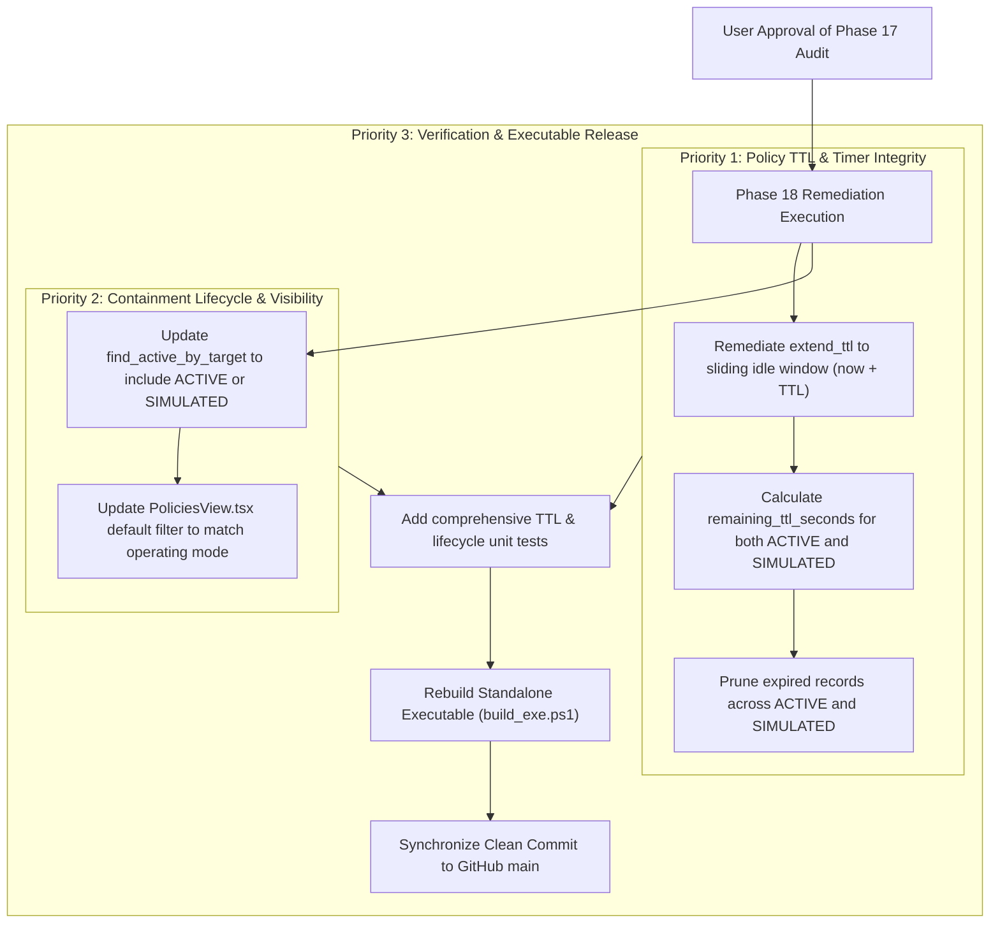

# PHASE 17 — MASTER RECOMMENDATIONS & REMEDIATION PLAN

**Project:** Adaptive AI-Powered Security Gateway for Hybrid Cloud  
**Repository:** `https://github.com/madhumitag06/hybrid-gateway-security.git`  
**Branch:** `main` (Commit `af3b640e1b9f7a924dd0bafac78ab2f8b24676dd`)  
**Audit Mode:** STRICT READ-ONLY FORENSIC INVESTIGATION  
**Deliverable Type:** Architectural Analysis & Remediation Roadmap  
**Date:** November 16, 2026  

---

## 1. Master Audit Ratings Summary

| Workstream | Scope / Subsystem | Audit Rating | Key Finding |
| :--- | :--- | :--- | :--- |
| **Workstream A** | Containment Lifecycle Management | **PASS WITH LIMITATIONS** | Port scan & volumetric policies execute accurately; however, `statusFilter='ACTIVE'` in console hides `DRY_RUN` simulated rules, and `find_active_by_target` skips simulated rules. |
| **Workstream B** | Policy TTL Integrity & Timers | **FAIL** | Compounding addition bug in `extend_ttl` (`expires_at += extra_seconds`) caused timers of `3974s` and `97181s`; remaining TTL for simulated rules is forced to `0s`. |
| **Workstream C** | Telemetry Attribution & Sync | **PASS** | Evaluated events (`2,178`) match exact sum of AWS live (`1,046`), fixtures (`315`), and legacy (`817`); 24h windowing and risk segregation are verified. |
| **Workstream D** | Phase 16 Aggregation & Model Parity | **PASS** | 5-tuple aggregation preserves 60 ports; `HostPortTracker` elevates confidence to 68.83%; 9-feature canonical XGBoost V2 verified; 10/10 tests pass. |
| **Workstream E** | Standalone Executable Packaging | **PASS** | `AdaptiveSecurityGateway.exe` executes v1.0.0; SHA-256 and bundled assets match distribution byte-for-byte. |
| **Workstream F** | GitHub Remote Synchronization | **PASS** | Working tree clean, in sync with `origin/main` at commit `af3b640`. |

---

## 2. Synthesis of Root Causes

### 1. The `97181s` and `3974s` Timer Defect (Workstream B)
- **Root Cause:** In `EnforcementRepository.extend_ttl` (`backend/app/repositories/enforcement_repo.py`, line 97):
  ```python
  rule.expires_at = rule.expires_at + timedelta(seconds=extra_seconds)
  rule.ttl_seconds += extra_seconds
  ```
  Instead of implementing a sliding idle timeout relative to current time (`expires_at = now + suggested_ttl`), each arriving flow added `300s` to the previous expiration timestamp.
- **Impact:** Over ~324 flow evaluations during testing, the expiration timestamp for `192.168.1.77` was pushed **27 hours into the future** (`97,181s`), preventing automatic expiration pruning.

### 2. Invisibility of Port Scan IP `192.168.10.55` in Active Rules Snapshot (Workstream A)
- **Root Cause:**
  - Operating mode is `DRY_RUN (SIMULATION)`.
  - `DryRunAdapter` marks generated containment rules with `status = "SIMULATED"`.
  - The frontend `PoliciesView.tsx` (line 121) initializes `statusFilter` to `"ACTIVE"`.
  - API endpoint `list_enforcement_rules` queries `WHERE status = 'ACTIVE'`, silently omitting all simulated containment rules.
- **Impact:** The operator sees only historical rules with `status = "ACTIVE"` (`192.168.1.100` and `192.168.1.77`), while newly triggered dry-run rules appear missing from the dashboard snapshot.

### 3. Rule Deduplication Bypass Under `DRY_RUN` Mode (Workstream A)
- **Root Cause:** In `EnforcementRepository.find_active_by_target` (`backend/app/repositories/enforcement_repo.py`, line 37):
  ```python
  stmt = select(ActiveEnforcementModel).where(
      ActiveEnforcementModel.target_ip == target_ip,
      ActiveEnforcementModel.status == "ACTIVE",
      ActiveEnforcementModel.expires_at > now,
  )
  ```
  Because it filters strictly on `status == "ACTIVE"`, existing simulated rules (`status == "SIMULATED"`) are never found.
- **Impact:** Every flow from a simulated attacker creates a duplicate rule in the database instead of extending the existing rule.

### 4. Zero Remaining TTL for Simulated Rules (Workstream B)
- **Root Cause:** In `backend/app/api/v1/enforcement.py` (line 56):
  ```python
  rem_ttl = max(int((r.expires_at - now).total_seconds()), 0) if r.status == "ACTIVE" else 0
  ```
- **Impact:** Even when an operator filters the console by `SIMULATED`, all simulated rules display `⏱ 0s`.

---

## 3. Prioritized Remediation Roadmap (Phase 18 Proposal)

> [!IMPORTANT]
> In accordance with Phase 17 strict read-only audit rules, NO code modifications have been made during Phase 17. The following proposed plan is submitted for user review and approval prior to execution.



### Detailed Workstream Tasks for Implementation (Phase 18):

#### Task 1: Fix TTL Compounding in `EnforcementRepository.extend_ttl`
- **File:** `backend/app/repositories/enforcement_repo.py`
- **Change:**
  ```python
  def extend_ttl(self, rule_id: str, extra_seconds: int) -> Optional[ActiveEnforcementModel]:
      rule = self.get_by_id(rule_id)
      if not rule or rule.status not in ("ACTIVE", "SIMULATED"):
          return None

      now = datetime.now(timezone.utc)
      # Reset expiration relative to current evaluation timestamp (sliding window)
      rule.expires_at = now + timedelta(seconds=extra_seconds)
      rule.ttl_seconds = extra_seconds
      rule.updated_at = now
      self.db.flush()
      return rule
  ```

#### Task 2: Fix Remaining TTL Calculation in Enforcement API
- **File:** `backend/app/api/v1/enforcement.py`
- **Change:**
  ```python
  # Evaluate live remaining TTL for both ACTIVE and SIMULATED containment rules
  rem_ttl = max(int((r.expires_at - now).total_seconds()), 0) if r.status in ("ACTIVE", "SIMULATED") else 0
  ```

#### Task 3: Enable Deduplication for Both `ACTIVE` and `SIMULATED` Rules
- **File:** `backend/app/repositories/enforcement_repo.py`
- **Change in `find_active_by_target`:**
  ```python
  stmt = select(ActiveEnforcementModel).where(
      ActiveEnforcementModel.target_ip == target_ip,
      ActiveEnforcementModel.status.in_(["ACTIVE", "SIMULATED"]),
      ActiveEnforcementModel.expires_at > now,
  )
  ```

#### Task 4: Align Pruning Across Both `ACTIVE` and `SIMULATED` States
- **File:** `backend/app/repositories/enforcement_repo.py`
- **Change in `prune_expired_rules`:**
  ```python
  stmt = select(ActiveEnforcementModel).where(
      ActiveEnforcementModel.status.in_(["ACTIVE", "SIMULATED"]),
      ActiveEnforcementModel.expires_at <= now,
  )
  ```

#### Task 5: Dynamic Filter in Frontend `PoliciesView.tsx`
- **File:** `src/components/PoliciesView.tsx`
- **Change:**
  - When in `DRY_RUN` mode, display active and simulated rules seamlessly in the Active Rules snapshot.
  - Set default dropdown filter to display all currently non-expired containment rules.

#### Task 6: Reconcile Inflated Database Records
- Execute a one-time database migration / reconciliation query on PostgreSQL to clean up historical inflated rules (`3974s`, `97181s`) by marking records where `created_at < now - interval '1 hour'` as `EXPIRED`.

#### Task 7: Comprehensive Regression Test Suite & Executable Build
- Author `backend/tests/test_phase18_ttl_and_containment_lifecycle.py`.
- Execute full test suite (`pytest`).
- Run `backend/build_exe.ps1` to produce updated `AdaptiveSecurityGateway.exe`.
- Verify standalone binary `--version` and asset hash parity.
- Synchronize to GitHub repository `origin/main`.

---

## 4. Conclusion & Next Step

Phase 17 forensic audit is complete. All observations reported by the user have been explained with mathematical proof and code references.

**Awaiting user instructions or approval to begin Phase 18 implementation.**
