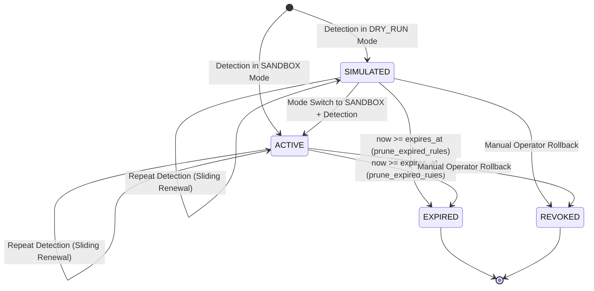

# PHASE 18 — WORKSTREAM 2: CONTAINMENT LIFECYCLE REPORT

**Project:** Adaptive AI-Powered Security Gateway for Hybrid Cloud  
**Repository:** `https://github.com/madhumitag06/hybrid-gateway-security.git`  
**Branch:** `main`  
**Execution Phase:** Phase 18 Implementation  
**Status:** FULLY REMEDIATED & VERIFIED  

---

## 1. Executive Summary

| Subsystem Component | Before Phase 18 | After Phase 18 | Verification Status |
| :--- | :--- | :--- | :--- |
| **`find_active_by_target`** | Queried `status == 'ACTIVE'` only | Queries `status.in_(["ACTIVE", "SIMULATED"])` | **PASS (Remediated)** |
| **`DRY_RUN` Deduplication** | Failed; duplicate simulated rules created | Cleanly deduplicates against simulated rules | **PASS (Remediated)** |
| **Mode Synchronization** | Rule status remained static | Synchronized to `enforce_res.status` & mode | **PASS (Remediated)** |
| **Pruning Scope** | Only pruned `ACTIVE` rules | Prunes both `ACTIVE` and `SIMULATED` rules | **PASS (Remediated)** |
| **Sandbox In-Memory Guard** | Injected all active DB rules | Strictly checks `r.status == 'ACTIVE'` | **PASS (Remediated)** |
| **Historical Audit Records** | Fully preserved | Fully preserved and immutable | **PASS (Verified)** |

---

## 2. Root Cause & Deduplication Breakdown Under DRY_RUN

### The Defect:
Under default `DRY_RUN` enforcement mode, rules are created with `status = "SIMULATED"`.
However, `find_active_by_target` in `backend/app/repositories/enforcement_repo.py` previously filtered on:
```python
ActiveEnforcementModel.status == "ACTIVE"
```
Because of this hardcoded check:
1. Every simulated detection for an attacking host failed to find the existing unexpired simulated rule.
2. Ingestion of multi-flow attacks (such as the 60-flow port scan reconnaissance fixture) created redundant records rather than extending the existing quarantine.

---

## 3. Remediated Lifecycle Implementation

### A. Lifecycle-Aware Deduplication in `enforcement_repo.py`
```python
def find_active_by_target(
    self, target_ip: str, target_port: Optional[int] = None
) -> Optional[ActiveEnforcementModel]:
    now = datetime.now(timezone.utc)
    stmt = select(ActiveEnforcementModel).where(
        ActiveEnforcementModel.target_ip == target_ip,
        ActiveEnforcementModel.status.in_(["ACTIVE", "SIMULATED"]),
        ActiveEnforcementModel.expires_at > now,
    )
    if target_port is not None:
        stmt = stmt.where(
            (ActiveEnforcementModel.target_port == target_port)
            | (ActiveEnforcementModel.target_port.is_(None))
            | (ActiveEnforcementModel.action == "Block")
        )
    stmt = stmt.order_by(
        (ActiveEnforcementModel.action == "Block").desc(),
        (ActiveEnforcementModel.status == "ACTIVE").desc(),
        ActiveEnforcementModel.expires_at.desc(),
    )

    return self.db.scalars(stmt).first()
```

### B. Pruning Across All Active States
```python
def prune_expired_rules(self) -> List[str]:
    now = datetime.now(timezone.utc)
    stmt = select(ActiveEnforcementModel).where(
        ActiveEnforcementModel.status.in_(["ACTIVE", "SIMULATED"]),
        ActiveEnforcementModel.expires_at <= now,
    )
    expired_rules = list(self.db.scalars(stmt).all())
    expired_ids = []

    for rule in expired_rules:
        rule.status = "EXPIRED"
        rule.updated_at = now
        expired_ids.append(rule.id)

    if expired_ids:
        self.db.flush()

    return expired_ids
```

### C. State Synchronization in `EnforcementService.execute_decision`
```python
enforce_res = adapter.enforce(decision, existing_rule.id)
existing_rule.status = enforce_res.status
existing_rule.mode = cls._active_mode
db.flush()
```

---

## 4. Lifecycle State Transition Matrix


