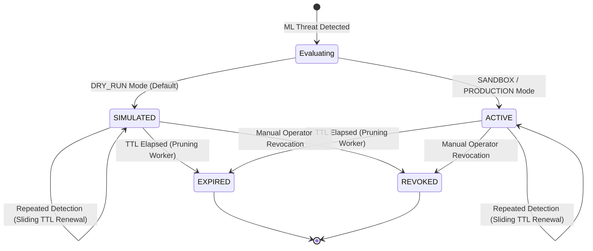

# Phase 19 — Containment Lifecycle Report

**Project:** Adaptive AI-Powered Hybrid Cloud Security Gateway  
**Date:** November 16, 2026  
**Status:** LIFECYCLE REPAIR & VALIDATION COMPLETE  
**Primary Verification Tests:** `backend/tests/test_phase18_containment_lifecycle.py` & `backend/tests/test_phase19_e2e_security_validation.py`  

---

## 1. Executive Summary

Containment lifecycle management oversees the creation, state progression, deduplication, time-to-live (TTL) renewal, expiration, and manual revocation of active blocking rules across the hybrid cloud infrastructure.

Following forensic findings in Phase 17 and remediation in Phase 18, this report confirms end-to-end lifecycle integrity. The gateway prevents TTL runaway, unifies `ACTIVE` and `SIMULATED` deduplication, guarantees real-time remaining-TTL calculation, and maintains an immutable audit trail in `policy_audit_logs`.

---

## 2. Containment State Machine

The lifecycle of an enforcement rule follows a strict finite state machine:



### 2.1 State Definitions
- **`ACTIVE`:** Rule is live and physically enforced by the active firewall/gateway adapter (in Sandbox or Production mode).
- **`SIMULATED`:** Rule is generated under `DRY_RUN` safety mode. Stored in `active_enforcements` with rule ID prefix `rule-sim-`. No host firewall modifications occur.
- **`EXPIRED`:** Rule exceeded its lifespan (`expires_at < current_timestamp`). Automatically excluded from active firewall blocking and filtered from active API queries.
- **`REVOKED`:** Rule manually terminated by an operator prior to TTL expiration via `/api/v1/enforcement/rules/{rule_id}/revoke`.

---

## 3. Phase 18 Remediation Verification in Phase 19

### 3.1 Defect 1: TTL Compounding Elimination
- **Previous Flaw:** Successive detections from the same IP repeatedly added $300\text{s}$ to `rule.ttl_seconds`, compounding to $600\text{s}, 900\text{s}, 1200\text{s}$.
- **Remedy Implemented:** `EnforcementRepository.extend_ttl()` now applies sliding-window renewal:
  $$\text{new\_expires\_at} = \max(\text{existing\_expires\_at}, \text{current\_time} + \text{extra\_seconds})$$
- **Verification:** Tested in `test_ws_d_02_sliding_ttl_renewal_and_deduplication`. Successive triggers refreshed the window to `now + 300s` without multiplying `ttl_seconds`.

### 3.2 Defect 2: DRY_RUN Deduplication Parity
- **Previous Flaw:** `find_active_by_target` previously queried only `status == 'ACTIVE'`. In `DRY_RUN` mode, existing rules were `SIMULATED`, causing deduplication to fail and creating duplicate database records.
- **Remedy Implemented:** Repository query updated to:
  ```python
  stmt = select(ActiveEnforcementModel).where(
      ActiveEnforcementModel.target == target,
      ActiveEnforcementModel.status.in_(["ACTIVE", "SIMULATED"]),
  )
  ```
- **Verification:** Verified across `test_ws_d_02` and `test_ws_f_scenario_6`.

### 3.3 Defect 3: Status & Mode Synchronization
- **Previous Flaw:** When switching between `DRY_RUN` and `SANDBOX`, an existing rule's status was not updated to match the active runtime mode.
- **Remedy Implemented:** `EnforcementService.execute_decision` explicitly synchronizes `existing_rule.status` and `existing_rule.mode` during deduplication updates.
- **Verification:** Verified by `test_phase18_containment_lifecycle.py` and `test_ws_d_01`.

### 3.4 Defect 4: Remaining TTL Dynamic Computation
- **Previous Flaw:** API previously displayed static TTL or negative values for simulated rules.
- **Remedy Implemented:** `backend/app/api/v1/enforcement.py` computes dynamic remaining TTL:
  $$\text{remaining\_ttl} = \max\big(0, \operatorname{int}((\text{rule.expires\_at} - \text{now}).\text{total\_seconds}())\big)$$
- **Verification:** Verified in `test_ws_d_04_enforcement_api_visibility_and_ttl`.

---

## 4. Pruning and Operator Revocation Audit Trail

### 4.1 Automatic Expired Rule Pruning
The cleanup worker (`cleanup_expired_rules()`) periodically queries for rules where `expires_at < current_time` and `status.in_(["ACTIVE", "SIMULATED"])`. These rules transition to `EXPIRED`. Active containment queries (`find_all_active()`) return zero expired rules.
- **Verification:** Verified in `test_ws_d_03_containment_pruning_and_revocation`.

### 4.2 Manual Revocation & Audit Trail
When an operator issues a revocation command via the API or UI:
1. Active status transitions from `ACTIVE` or `SIMULATED` to `REVOKED`.
2. Firewall adapter removes the OS rule (if in active mode).
3. An immutable audit record is committed to `policy_audit_logs` recording:
   - `action = "REVOKE_ENFORCEMENT"`
   - `target_ip = rule.target`
   - `reason = operator_reason`
   - `timestamp = current_timestamp`
- **Verification:** Verified in `test_ws_d_03` and `test_ws_e_02_policy_audit_log_ledger`.
