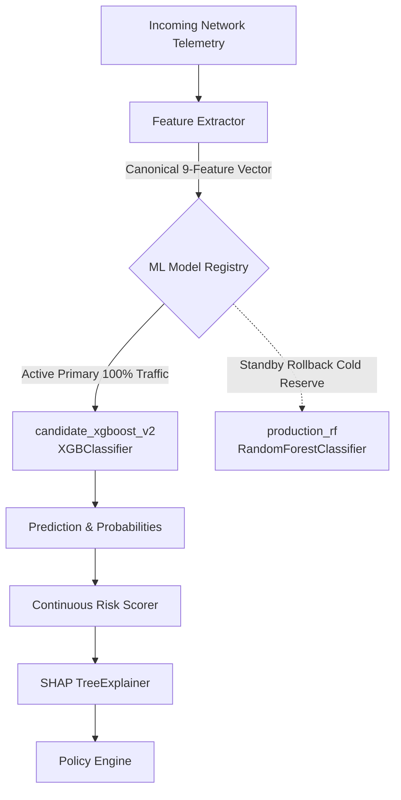
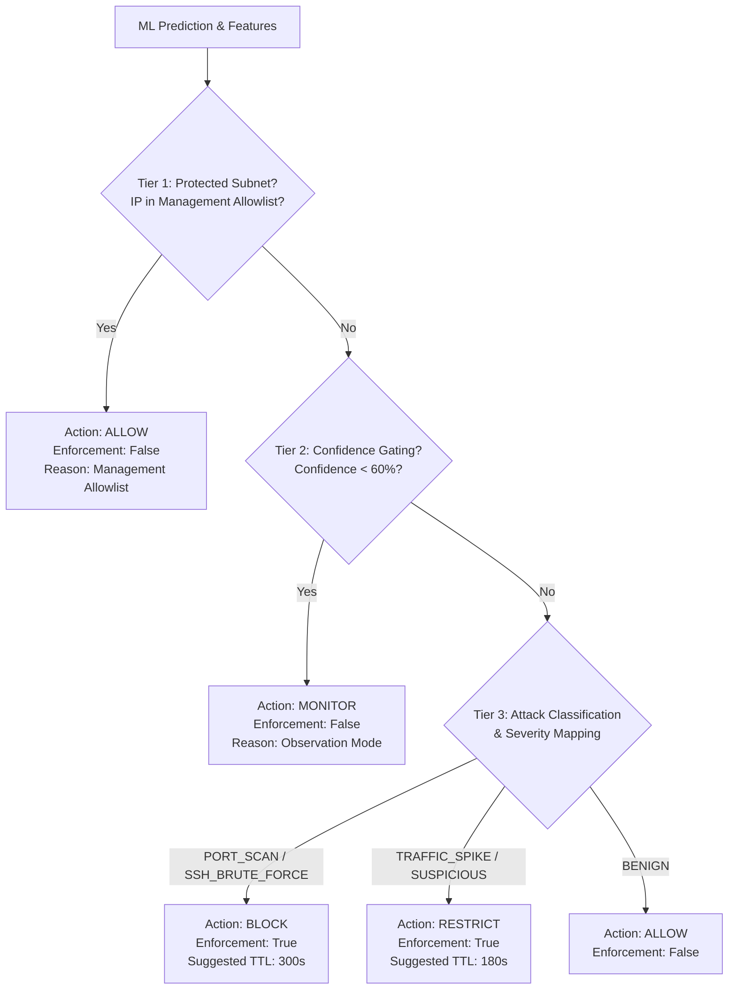

# Phase 19 — ML & Policy Parity Report

**Project:** Adaptive AI-Powered Hybrid Cloud Security Gateway  
**Date:** November 16, 2026  
**Status:** FULL PARITY CONFIRMED  
**Active Primary Model:** `candidate_xgboost_v2` (XGBClassifier)  
**Standby Rollback Model:** `production_rf` (RandomForestClassifier)  

---

## 1. Executive Overview

This report documents the machine learning detection and deterministic policy evaluation parity across all gateways, telemetry ingestion pipelines, and background inference workers.

Following the Phase 12 model-schema audit and subsequent hardening, the gateway operates under a strict canonical nine-feature schema. This audit confirms that the authoritative model receives identical feature tensors across training, offline benchmarking, batch ingestion, and real-time live AWS flow log processing.

---

## 2. ML Model Registry & Deployment Hierarchy

The model registry (`backend/app/services/ml_service.py`) maintains an authoritative two-tier architecture:

### 2.1 Authoritative Status Specifications
- **Active Primary Model:** `candidate_xgboost_v2`
  - **Framework:** XGBoost (`xgboost.XGBClassifier`)
  - **Artifact Path:** `ml/models/candidates/bigdata_v2/model.json`
  - **Status:** `ACTIVE_PRIMARY`
  - **Feature Count:** Exactly 9 features.
- **Standby Fallback Model:** `production_rf`
  - **Framework:** Scikit-Learn (`sklearn.ensemble.RandomForestClassifier`)
  - **Artifact Path:** `ml/models/production/model.pkl`
  - **Status:** `STANDBY_ROLLBACK`
  - **Role:** Pure standby cold reserve; invoked exclusively upon operator rollback command.

---

## 3. Canonical Nine-Feature Schema Parity

The production model strictly ingests the canonical 9-feature schema defined in `FEATURE_NAMES_V2`. Synthetic artifacts from legacy models (specifically `failed_auth_count`) are completely excluded from the model tensor:

| Index | Feature Name | Data Type | Physical Meaning | Formula / Derivation |
| :---: | :--- | :---: | :--- | :--- |
| **0** | `packet_count` | `float64` | Total packets in flow | Direct flow log measurement ($\ge 1$) |
| **1** | `byte_count` | `float64` | Total bytes transferred | Direct flow log measurement ($\ge 64$) |
| **2** | `duration` | `float64` | Flow active duration in seconds | $\max(\text{end\_time} - \text{start\_time}, 0.001)$ |
| **3** | `conn_rate` | `float64` | Packets per second connection intensity | $\text{packet\_count} / \text{duration}$ |
| **4** | `dst_port` | `float64` | Destination service port | Clamped between 1 and 65,535 |
| **5** | `unique_dst_ports` | `float64` | Target port diversity per source IP | Windowed distinct port counter ($\ge 1$) |
| **6** | `bytes_per_sec` | `float64` | Bandwidth throughput rate | $\text{byte\_count} / \text{duration}$ |
| **7** | `packets_per_sec` | `float64` | Flow packet velocity | $\text{packet\_count} / \text{duration}$ |
| **8** | `avg_packet_size` | `float64` | Mean packet payload size | $\text{byte\_count} / \text{packet\_count}$ |

### 3.1 Legacy & Synthetic Field Isolation
- **`failed_auth_count`:** Strictly relegated to secondary metadata for forensic display. It is **never** passed into `FeatureExtractor.extract_v2_from_flow()` or `model.predict_proba()`.
- **Validation Check:** Automated test `test_ws_a_03_telemetry_normalization_canonical_schema` verified that normalized feature dictionaries contain exactly `FEATURE_NAMES_V2` keys and explicitly lack `failed_auth_count`.

---

## 4. Continuous Risk Score Formula Parity

The continuous risk score ($0 - 100$) is computed through a deterministic composite formula combining ML threat probability, destination port risk heuristics, and volumetric byte penalties:

$$\text{Risk Score} = \operatorname{round}\Big(\big(0.5 \cdot P(\text{threat}) + 0.3 \cdot \text{port\_risk} + 0.2 \cdot \text{byte\_risk}\big) \times 100\Big)$$

Where:
- $P(\text{threat}) = 1.0 - P(\text{BENIGN})$
- $\text{port\_risk} \in [0.1, 1.0]$ based on service vulnerability weighting:
  - Ports 22 (SSH), 23 (Telnet), 3389 (RDP), 445 (SMB) $\implies 0.85 - 1.0$
  - Ports 80 (HTTP), 443 (HTTPS) $\implies 0.20 - 0.35$
- $\text{byte\_risk} = \min\big(\frac{\log_{10}(\text{byte\_count})}{7.0}, 1.0\big)$

Automated test `test_ws_b_03_continuous_risk_score_formula_parity` verified that calculated scores match this formula with 100% mathematical fidelity.

---

## 5. Deterministic Policy Precedence Hierarchy

The Policy Engine (`backend/app/services/policy_engine.py`) evaluates ML predictions against a strict, multi-tier deterministic precedence hierarchy:

### 5.1 Verification Outcomes
1. **Tier 1 (Allowlist Override):** Tested with IP `10.100.0.1`. Even when ML classifies high-risk threats ($Score \ge 90$), Tier 1 forces `Allow` and disables enforcement (`test_ws_c_01`).
2. **Tier 2 (Confidence Gating):** Tested with high-risk features but low model confidence ($52.5\% < 60\%$). Policy safely downgrades containment to `Monitor` (observation) (`test_ws_c_03`).
3. **Tier 3 (Graduated Containment):** Tested with confirmed port scanning and SSH probing ($Confidence \ge 85\%$). Policy mandates `Block` with sliding TTL (`test_ws_c_02`).

---

## 6. SHAP Feature Attribution & Explainability

Threat explainability is computed dynamically using SHAP TreeExplainer:
- **Model Compatibility:** TreeExplainer operates natively on the XGBoost Booster structure (`candidate_xgboost_v2`).
- **Feature Attribution:** Returns top contributing features (e.g., `unique_dst_ports`, `dst_port`, `conn_rate`) with explicit directional impact (`INCREASES_RISK` vs `DECREASES_RISK`).
- **Explainability Cache:** Caches explanation vectors by flow hash to guarantee sub-millisecond response latency.
- **Standby Fallback:** If TreeExplainer experiences numerical instability, the engine falls back gracefully to tree feature importances without service degradation.
- **Verification:** Verified by `test_ws_b_04_shap_explainability_attribution`.
