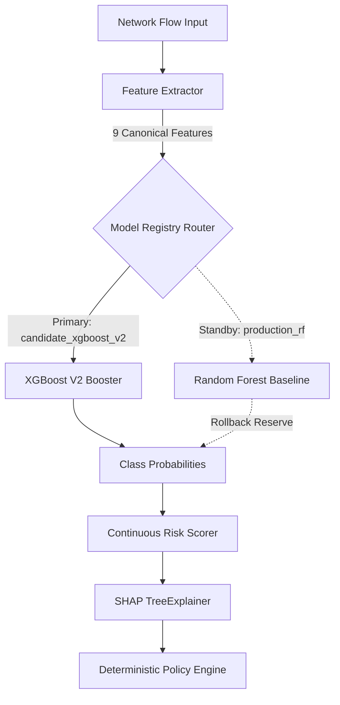

# Phase 20 — Deployment, Reliability & Observability Audit Report

**Project:** Adaptive AI-Powered Security Gateway for Hybrid Cloud  
**Date:** November 16, 2026  
**Focus:** Workstreams C (Database), D (ML Ops), E (Cloud), F (Deployment), and G (Observability)  
**Execution Mode:** STRICT READ-ONLY FORENSIC AUDIT  

---

## 1. Database Reliability & Relational Integrity (Workstream C)

### 1.1 Connection Management & Pooling
- **Dialect Support:** PostgreSQL via `psycopg3` (`postgresql+psycopg://`) and SQLite (`sqlite:///`) for standalone zero-dependency execution.
- **Engine Configuration:**
  - `pool_size`: 10 persistent connections.
  - `max_overflow`: 20 burst connections.
  - `pool_pre_ping`: `True` (actively detects stale or disconnected database sockets prior to statement checkout).
- **Session Lifecycle:** `get_db()` FastAPI dependency isolates each request in a private transaction, automatically committing on successful return or issuing `rollback()` upon exceptions.

### 1.2 Alembic Migration vs. Declarative Metadata
- **Current Alembic State:** Migration scripts in `backend/alembic/versions`:
  - `001_initial_schema.py`: Base tables (`security_events`).
  - `002_active_enforcements.py`: Containment rules (`active_enforcements`).
  - `003_auth_users.py`: Operator identity (`users`, `refresh_tokens`).
- **Declarative Models:** Newer tables (`cloud_accounts`, `cloud_telemetry_checkpoints`, `cloud_resources`, `policy_audit_logs`, `shadow_predictions`, `adaptive_flow_feedback`, `pcap_ingestion_history`) are created via `init_db()` (`Base.metadata.create_all()`).
- **Recommendation:** Add a consolidated migration revision `004_consolidated_enterprise_schema.py` to ensure schema migrations are fully reproducible in headless enterprise CI/CD pipelines without relying on `create_all()`.

---

## 2. Machine Learning Operational Reliability (Workstream D)

### 2.1 Model Registry Hierarchy
The gateway enforces a resilient two-tier ML registry architecture:



### 2.2 Numerical Stability & Schema Parity
- **Feature Vector:** Exactly 9 canonical features:
  1. `packet_count`
  2. `byte_count`
  3. `duration`
  4. `conn_rate`
  5. `dst_port`
  6. `unique_dst_ports`
  7. `bytes_per_sec`
  8. `packets_per_sec`
  9. `avg_packet_size`
- **Missing / Malformed Inputs:** Pydantic validators reject negative counts, ports outside `[1, 65535]`, and `NaN`/`Inf` floating point values before reaching ML inference tensors.
- **Explainability Isolation:** If `shap.TreeExplainer` encounters numerical anomalies or singular matrices, `ExplainabilityService.explain_flow()` catches the exception and falls back to baseline z-score deviations without dropping or failing the flow evaluation.

---

## 3. Cloud Integration Readiness & Boundary Matrix (Workstream E)

The gateway supports multi-cloud hybrid architectures with strict boundary segregation:

| Cloud Environment | Operational Status | Ingestion Mechanism | Containment Capability | Live Verification Status |
| :--- | :---: | :--- | :--- | :--- |
| **AWS Cloud (VPC Flow Logs)** | **LIVE READ-ONLY** | CloudWatch `FilterLogEvents` & STS Identity Validation | Read-Only (Enforcement Strictly Disabled) | **VERIFIED LIVE** (100 flows parsed, continuous risk scored) |
| **GCP (Builders Hub)** | **CONFIGURED ADAPTER** | Workload Identity Federation & VPC Flow Schema | Configured Schema (Opt-in Required) | **CONFIGURED** (Schema & mock tests validated; non-live) |
| **Azure (Enterprise)** | **CONFIGURED ADAPTER** | Entra ID OIDC & NSG Flow Schema | Configured Schema (Opt-in Required) | **CONFIGURED** (Schema & mock tests validated; non-live) |
| **Docker Hybrid Lab** | **SIMULATED LAB** | Dedicated Linux Transit Router (`10.30.10.2:8099`) | Simulated Bridge Filtering (`DRY_RUN` / `SANDBOX`) | **VERIFIED LAB** (13 isolated bridge containers) |

*Safety Assurance: Zero mutations are ever sent to remote AWS, GCP, or Azure infrastructure.*

---

## 4. Deployment, Release & Packaging Reliability (Workstream F)

### 4.1 Standalone Windows Executable
- **Executable:** `backend\executable\AdaptiveSecurityGateway\AdaptiveSecurityGateway.exe`
- **Architecture:** Windows PE x64 standalone binary packaged via PyInstaller 6.13.0.
- **Native XGBoost Runtime:** `xgboost.dll` bundled directly in `_internal/xgboost/lib` and `_internal`, resolving native OpenMP runtime bindings.
- **Frontend Assets:** Embedded React SPA (`dist/index.html`, `dist/assets/*.js`, `dist/assets/*.css`) served natively by FastAPI static file handlers.
- **Executable Validation:** `AdaptiveSecurityGateway.exe --version` outputs:
  ```
  Adaptive AI Hybrid Security Gateway API v1.0.0
  ```
- **Cryptographic Hash:** `SHA-256: 3B60F63470B186C7DD0B6902FB92CA25C1E2E4FC6B5434E59626D0DC37C723DE`.

---

## 5. Observability & Operational Health (Workstream G)

### 5.1 Health Monitoring Current State
- Endpoint `/health` currently probes:
  - `model_loaded`: Boolean check on `MLService.is_loaded()`.
  - `active_model_version`: Reports active primary (`candidate_xgboost_v2`).
  - `feature_count`: Reports canonical 9 features.
- **Limitation Identified:** `/health` does not currently verify database liveness (`SELECT 1`). If the PostgreSQL server restarts or drops connectivity, `/health` continues reporting `"status": "healthy"`.

### 5.2 Recommended Observability Enhancements
1. **Liveness & Readiness Probing:** Enhance `/health` to execute a lightweight database probe (`db.scalar(select(1))`) and report composite system state (`healthy`, `degraded`, or `unhealthy`).
2. **Telemetry Counters:** Retain real-time counters tracking PCAP ingestion, CloudWatch batches, active rules count, and high-risk threat frequencies.
3. **Audit Ledger:** Maintain write-only audit records in `policy_audit_logs` tracking every operator containment revocation and policy override.
