# POST-IMPLEMENTATION FINAL READINESS REPORT: XGBOOST EXE PACKAGING, PCAP PERSISTENCE & ADAPTIVE ML LEARNING

**Project:** Adaptive AI-Powered Security Gateway for Hybrid Cloud  
**Target Repository:** `https://github.com/madhumitag06/hybrid-gateway-security.git`  
**Branch:** `main`  
**Status:** COMPLETED, AUDITED & READY FOR OPERATOR VERIFICATION  

---

## 1. Executive Summary

This master implementation successfully resolves the standalone Windows executable packaging issues, establishes full database-backed state persistence for raw network PCAP ingestion, and deploys an end-to-end feedback-driven adaptive machine learning retraining pipeline.

All workstreams were executed in strict compliance with safety rules:
1. Zero Git commits or pushes were executed; the local working tree is preserved intact.
2. Zero modifications were made to the Windows host firewall or external AWS infrastructure.
3. Zero database drops, Docker volume resets, or model deletions occurred.
4. Active and standby models (`ml/models/model.joblib` and `ml/models/candidates/bigdata_v2/model.joblib`) were strictly preserved.
5. In accordance with the **Strict No-Localhost Testing Policy**, zero browser visits and zero HTTP network requests were issued to `localhost` or `127.0.0.1`.

All 196 automated backend unit and integration tests passed (100%), the production frontend Vite build compiled in 249 ms, and the standalone executable `AdaptiveSecurityGateway.exe` was packaged with all 17 automated pipeline verification steps confirmed.

---

## 2. Workstream Synthesis & Technical Solutions

```mermaid
flowchart TD
    subgraph W1["Workstream 1: Standalone EXE XGBoost Packaging"]
        A1["AdaptiveSecurityGateway.spec"] -->|Dynamic Library Collection| A2["_internal/xgboost/lib/xgboost.dll"]
        A2 -->|Build Verification| A3["AdaptiveSecurityGateway.exe (34.85 MB)"]
        A3 -->|Startup Check| A4["Auto-Fallback to Random Forest if missing"]
    end

    subgraph W2["Workstream 2: PCAP Persistence & State Recovery"]
        B1["Uploaded / Sample PCAP"] -->|Scapy Offline Stream| B2["pcap_ingestions (PostgreSQL)"]
        B2 -->|REST APIs: /latest, /history| B3["PcapIngestView State Auto-Recovery"]
        B3 -->|Persist across navigation| B4["Zero telemetry loss on tab switch"]
    end

    subgraph W3["Workstream 3: Adaptive ML Learning & Feedback Pipeline"]
        C1["Evaluated Flows"] -->|Auto-seed| C2["adaptive_flow_feedbacks (PostgreSQL)"]
        C2 -->|Analyst Ledger: Confirm/Correct/Exclude| C3["Versioned Dataset (Schema + NaN/Inf checks)"]
        C3 -->|Min 5 Verified Samples| C4["Isolated Retraining: ml/models/candidates/<ver>/"]
        C4 -->|Accuracy >= 95%, F1 >= 90%| C5["Controlled Promotion & Safety Rollback"]
    end
```

---

### Workstream 1: Standalone EXE XGBoost Packaging Fix
- **Root Cause**: `AdaptiveSecurityGateway.spec` previously configured `binaries=[]`, leaving out the native C++ dynamic library `xgboost.dll`.
- **Solution**:
  - Configured `collect_dynamic_libs("xgboost")` and `collect_dynamic_libs("lightgbm")`.
  - Added binary tuples ensuring `xgboost.dll` is placed in `_internal/xgboost/lib/xgboost.dll` and `_internal/xgboost.dll`.
  - Updated `backend/build_exe.ps1` to assert the presence of `xgboost.dll` and both model binaries.
  - Added startup logging and active/standby fallback in `backend/app/main.py`.
- **Reference**: Full technical report available at [XGBOOST_EXE_PACKAGING_FIX_REPORT.md](file:///c:/Users/LENOVO/Desktop/hybrid-gateway-security/XGBOOST_EXE_PACKAGING_FIX_REPORT.md).

---

### Workstream 2: PCAP Ingestion State Persistence & Recovery
- **Root Cause**: PCAP parsing results previously lived only in volatile client-side React memory. Navigating away cleared the screen.
- **Scapy Libpcap Warning**: Investigated and confirmed non-fatal for offline packet parsing. `scapy.utils.PcapReader` runs purely on Python binary struct unpacking with zero dependency on Npcap/libpcap.
- **Solution**:
  - Implemented PostgreSQL model `PcapIngestionModel` mapped to table `pcap_ingestions`.
  - Added REST endpoints: `GET /api/v1/ingest/latest`, `GET /api/v1/ingest/history`, `GET /api/v1/ingest/history/{id}`.
  - Updated `PcapIngestView.tsx` with lifecycle hooks to automatically re-populate the latest completed ingestion on tab navigation and page reload.
  - Added historical ingestion ledger allowing operators to view and reload past captures.
- **Reference**: Full technical report available at [PCAP_INGESTION_PERSISTENCE_REPORT.md](file:///c:/Users/LENOVO/Desktop/hybrid-gateway-security/PCAP_INGESTION_PERSISTENCE_REPORT.md).

---

### Workstream 3: Safe, Feedback-Driven Adaptive ML Retraining Pipeline
- **Solution Architecture**:
  - **Stage A (Buffering)**: Every flow evaluated during PCAP or VPC log parsing is auto-seeded into `adaptive_flow_feedbacks` with `UNVERIFIED` status.
  - **Stage B (Review Ledger)**: Analysts can confirm (`CONFIRM`), correct (`CORRECT`), or exclude (`EXCLUDE`) flows. Only verified flows are flagged `is_training_eligible = True`.
  - **Stage C (Dataset Management)**: Enforces sample threshold ($N \ge 5$), 9-feature schema parity, and zero `NaN`/`Inf`. Replays anchor multi-dataset distributions to eliminate catastrophic forgetting.
  - **Stage D (Isolated Retraining)**: Retrains candidate models inside isolated directories `ml/models/candidates/<candidate_version>/`. Production models in `ml/models/` are never touched during training.
  - **Stage E (Promotion Acceptance Gate)**: All candidate runs are tracked in `adaptive_training_runs` with Accuracy, F1, FPR, and FNR. Candidates remain advisory until explicit administrator approval.
  - **Stage F (Rollback)**: Promoted models retain the previous model on standby. Rollback restores the standby model instantaneously.
- **References**: Full reports available at [ADAPTIVE_ML_LEARNING_PIPELINE_REPORT.md](file:///c:/Users/LENOVO/Desktop/hybrid-gateway-security/ADAPTIVE_ML_LEARNING_PIPELINE_REPORT.md) and [MODEL_FEEDBACK_AND_RETRAINING_REPORT.md](file:///c:/Users/LENOVO/Desktop/hybrid-gateway-security/MODEL_FEEDBACK_AND_RETRAINING_REPORT.md).

---

### Workstream 4: UI Consistency & Status Corrections
- Replaced outdated static copy ("run Random Forest ML threat detection") on the PCAP Ingestion console with dynamic indicators reflecting the active Model Registry status:
  `Active: XGBoost V2 (Authoritative) • Standby: Random Forest V1`
- Integrated a third primary tab in `EvaluationView.tsx`:
  `[⚡ Experimental Benchmark Suite] | [🛡️ Candidate Model Shadow Mode] | [🧠 Adaptive ML Learning & Feedback]`
- Built a comprehensive Adaptive Learning UI featuring telemetry stats cards, an interactive flow feedback review ledger, a versioned dataset preparation card, an isolated candidate retraining card, and a candidate evaluation and promotion gate.

---

### Workstream 5: Regression Testing & Executable Packaging
- **Unit and Integration Tests**: 196/196 tests passed (100%) in 34.29 seconds.
- **Packaging Pipeline**: Executed `backend/build_exe.ps1` with all 17 steps verified:
  - Frontend compiled cleanly (`dist/assets/index-DQlUhziI.js`, `dist/assets/index-DgMRxSro.css`).
  - Native library `_internal/xgboost/lib/xgboost.dll` verified.
  - Both model artifacts (`model.joblib` and `candidates/bigdata_v2/model.joblib`) bundled.
  - Executable size: **34.85 MB**.
  - Backup preserved: `backend/executable/AdaptiveSecurityGateway_backup`.
  - CLI startup metadata verified: `Adaptive AI Hybrid Security Gateway API v1.0.0`.
- **Reference**: Full technical report available at [FINAL_REGRESSION_AND_BUILD_REPORT.md](file:///c:/Users/LENOVO/Desktop/hybrid-gateway-security/FINAL_REGRESSION_AND_BUILD_REPORT.md).

---

## 3. Repository File Index

The following core files were created or updated during this implementation:

### Backend Services & Models
- [`backend/app/models/pcap_ingestion.py`](file:///c:/Users/LENOVO/Desktop/hybrid-gateway-security/backend/app/models/pcap_ingestion.py): Persistent PCAP ingestion database model.
- [`backend/app/models/adaptive_learning.py`](file:///c:/Users/LENOVO/Desktop/hybrid-gateway-security/backend/app/models/adaptive_learning.py): Flow feedback and candidate retraining run models.
- [`backend/app/models/__init__.py`](file:///c:/Users/LENOVO/Desktop/hybrid-gateway-security/backend/app/models/__init__.py): Model registration in SQLAlchemy Base.
- [`backend/app/services/ingestion_service.py`](file:///c:/Users/LENOVO/Desktop/hybrid-gateway-security/backend/app/services/ingestion_service.py): PCAP persistence and automated feedback seeding.
- [`backend/app/services/adaptive_learning_service.py`](file:///c:/Users/LENOVO/Desktop/hybrid-gateway-security/backend/app/services/adaptive_learning_service.py): 6-stage adaptive learning service.
- [`backend/app/services/ml_service.py`](file:///c:/Users/LENOVO/Desktop/hybrid-gateway-security/backend/app/services/ml_service.py): Dynamic candidate registration and model rollback.
- [`backend/app/api/v1/ingest.py`](file:///c:/Users/LENOVO/Desktop/hybrid-gateway-security/backend/app/api/v1/ingest.py): Persistent PCAP `/latest`, `/history`, and `/history/{id}` endpoints.
- [`backend/app/api/v1/adaptive.py`](file:///c:/Users/LENOVO/Desktop/hybrid-gateway-security/backend/app/api/v1/adaptive.py): 8 adaptive learning and promotion endpoints.
- [`backend/app/main.py`](file:///c:/Users/LENOVO/Desktop/hybrid-gateway-security/backend/app/main.py): XGBoost native DLL startup discovery and router mounting.

### Build & Packaging Infrastructure
- [`AdaptiveSecurityGateway.spec`](file:///c:/Users/LENOVO/Desktop/hybrid-gateway-security/AdaptiveSecurityGateway.spec): PyInstaller spec with native dynamic libraries and model bundling.
- [`backend/build_exe.ps1`](file:///c:/Users/LENOVO/Desktop/hybrid-gateway-security/backend/build_exe.ps1): 17-point automated packaging and verification script.

### Frontend Components & Services
- [`src/services/ingestion.ts`](file:///c:/Users/LENOVO/Desktop/hybrid-gateway-security/src/services/ingestion.ts): Client APIs for latest ingestion and history.
- [`src/services/adaptive.ts`](file:///c:/Users/LENOVO/Desktop/hybrid-gateway-security/src/services/adaptive.ts): Client APIs for adaptive feedback, retraining, promotion, and rollback.
- [`src/components/PcapIngestView.tsx`](file:///c:/Users/LENOVO/Desktop/hybrid-gateway-security/src/components/PcapIngestView.tsx): Persistent ingestion console with history ledger.
- [`src/components/EvaluationView.tsx`](file:///c:/Users/LENOVO/Desktop/hybrid-gateway-security/src/components/EvaluationView.tsx): Adaptive ML Learning and Feedback Dashboard.

### Automated Tests
- [`backend/tests/test_pcap_persistence_and_adaptive.py`](file:///c:/Users/LENOVO/Desktop/hybrid-gateway-security/backend/tests/test_pcap_persistence_and_adaptive.py): Full persistence and adaptive ML test suite.

---

## 4. Technical Documentation Artifacts

1. [XGBOOST_EXE_PACKAGING_FIX_REPORT.md](file:///c:/Users/LENOVO/Desktop/hybrid-gateway-security/XGBOOST_EXE_PACKAGING_FIX_REPORT.md)
2. [PCAP_INGESTION_PERSISTENCE_REPORT.md](file:///c:/Users/LENOVO/Desktop/hybrid-gateway-security/PCAP_INGESTION_PERSISTENCE_REPORT.md)
3. [ADAPTIVE_ML_LEARNING_PIPELINE_REPORT.md](file:///c:/Users/LENOVO/Desktop/hybrid-gateway-security/ADAPTIVE_ML_LEARNING_PIPELINE_REPORT.md)
4. [MODEL_FEEDBACK_AND_RETRAINING_REPORT.md](file:///c:/Users/LENOVO/Desktop/hybrid-gateway-security/MODEL_FEEDBACK_AND_RETRAINING_REPORT.md)
5. [FINAL_REGRESSION_AND_BUILD_REPORT.md](file:///c:/Users/LENOVO/Desktop/hybrid-gateway-security/FINAL_REGRESSION_AND_BUILD_REPORT.md)
6. [FINAL_MANUAL_VERIFICATION_CHECKLIST.md](file:///c:/Users/LENOVO/Desktop/hybrid-gateway-security/FINAL_MANUAL_VERIFICATION_CHECKLIST.md)

