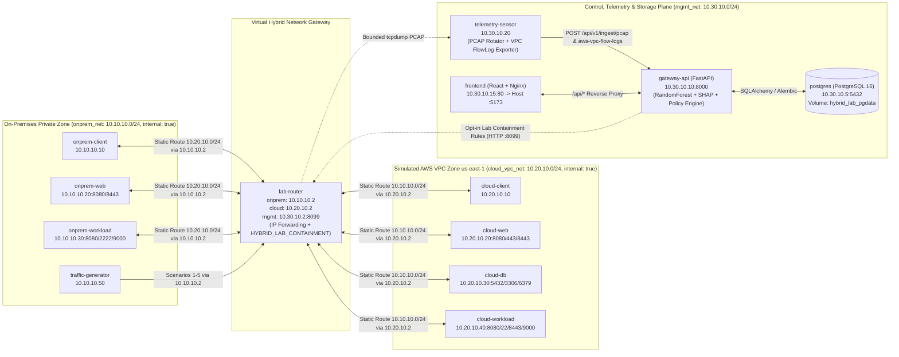

# Adaptive AI-Powered Security Gateway — Virtual Hybrid-Cloud Environment (`deployment/hybrid-lab`)

## 1. Overview & Architectural Purpose

This directory contains a complete, isolated, Docker Compose-based **Virtual Hybrid-Cloud Security Lab** designed to demonstrate how enterprise network traffic traverses an on-premises private network and a cloud VPC boundary under the continuous monitoring, threat detection, explainable AI (SHAP) attribution, deterministic policy evaluation, and containment control of the **Adaptive AI-Powered Security Gateway**.

> [!IMPORTANT]
> **Explicit Representation Notice**: The Cloud VPC segment (`cloud_vpc_net`, `10.20.10.0/24`) is a **Simulated AWS-Style VPC (`us-east-1`)** running inside isolated Docker bridge networks. It does not connect to or modify live AWS cloud infrastructure, Windows host firewall rules, or host routing tables.

---

## 2. Four-Plane Architecture & Mermaid Topology Diagram

The environment separates responsibilities across four distinct planes:

1. **Data Plane (`onprem_net` ↔ `lab-router` ↔ `cloud_vpc_net`)**: Real TCP/HTTP/DB packets moving between private on-premises workloads and simulated cloud VPC workloads through a single Linux virtual router (`lab-router`).
2. **Telemetry Plane (`lab-router` → `telemetry-sensor` → `hybrid_lab_telemetry`)**: Bounded `tcpdump` packet capture on `lab-router`'s transit interfaces (`eth_onprem` / `eth_cloud`), automatic conversion to 15-column AWS VPC Flow Logs v2 records, and automated ingestion into the gateway API.
3. **Control Plane (`gateway-api` + `frontend` on `mgmt_net`)**: The existing FastAPI application executing Random Forest classification (`BENIGN`, `PORT_SCAN`, `BRUTE_FORCE`, `TRAFFIC_SPIKE`, `SUSPICIOUS_TRANSFER`), conditional SHAP `TreeExplainer` attributions, composite risk scoring, deterministic `Allow → Monitor → Restrict → Block` policy evaluation, and sandboxed/opt-in router containment.
4. **Storage Plane (`postgres` + `hybrid_lab_pgdata` on `mgmt_net`)**: Persistent PostgreSQL storage for `security_events`, `policy_audit_logs`, and `users` across container restarts.



---

## 3. Network Subnets, Isolation & IP Addressing Table

| Network Name | Docker Bridge Name | Subnet CIDR | Bridge Gateway | `internal` | Purpose |
| :--- | :--- | :--- | :--- | :--- | :--- |
| `onprem_net` | `hybrid_lab_onprem_net` | `10.10.10.0/24` | `10.10.10.1` | `true` | Isolated On-Premises Private Infrastructure |
| `cloud_vpc_net` | `hybrid_lab_cloud_vpc_net` | `10.20.10.0/24` | `10.20.10.1` | `true` | Isolated Simulated AWS-Style Cloud VPC (`us-east-1`) |
| `mgmt_net` | `hybrid_lab_mgmt_net` | `10.30.10.0/24` | `10.30.10.1` | `false` | Out-of-Band Control, Telemetry & Storage Plane |

### Container IP & Service Inventory (13 Services)

| Service Name | Zone | Network(s) & Static IP(s) | Exposed Ports (Internal / Host) | Role & Capabilities |
| :--- | :--- | :--- | :--- | :--- |
| `lab-router` | Hybrid Transit Gateway | `onprem_net`: `10.10.10.2`<br/>`cloud_vpc_net`: `10.20.10.2`<br/>`mgmt_net`: `10.30.10.2` | `8099/tcp` (mgmt only) | Sole L3 router between On-Prem and Cloud VPC; runs `iptables` `HYBRID_LAB_CONTAINMENT` chain and `router_agent.py`. Caps: `NET_ADMIN`, `NET_RAW`. |
| `onprem-client` | `ON_PREMISE` | `onprem_net`: `10.10.10.10` | `8080/tcp` | Employee workstation initiating periodic cross-zone HTTP heartbeats to `10.20.10.20:8080`. |
| `onprem-web` | `ON_PREMISE` | `onprem_net`: `10.10.10.20` | `8080/tcp`, `8443/tcp` | Internal enterprise web portal accessible from Cloud VPC via `lab-router`. |
| `onprem-workload` | `ON_PREMISE` | `onprem_net`: `10.10.10.30` | `8080/tcp`, `2222/tcp`, `9000/tcp` | Private batch & integration server. |
| `traffic-generator` | `ON_PREMISE` | `onprem_net`: `10.10.10.50` | N/A | Bounded 5-scenario traffic generator (`CPU <= 0.50`, `Mem <= 256M`). |
| `cloud-client` | `AWS_VPC` (Simulated) | `cloud_vpc_net`: `10.20.10.10` | `8080/tcp` | Cloud worker instance initiating periodic cross-zone HTTP heartbeats to `10.10.10.20:8080`. |
| `cloud-web` | `AWS_VPC` (Simulated) | `cloud_vpc_net`: `10.20.10.20` | `8080/tcp`, `443/tcp`, `8443/tcp` | Simulated AWS VPC web service endpoint. |
| `cloud-db` | `AWS_VPC` (Simulated) | `cloud_vpc_net`: `10.20.10.30` | `8080/tcp`, `5432/tcp`, `3306/tcp`, `6379/tcp` | Simulated AWS VPC private database responder (PostgreSQL/MySQL/Redis wire banners). |
| `cloud-workload` | `AWS_VPC` (Simulated) | `cloud_vpc_net`: `10.20.10.40` | `8080/tcp`, `22/tcp`, `2222/tcp`, `8443/tcp`, `9000/tcp` | Simulated AWS VPC compute & storage node. |
| `telemetry-sensor` | Control / Telemetry | `mgmt_net`: `10.30.10.20` | N/A | Triggers bounded PCAP rotation on `lab-router`, exports AWS VPC Flow Logs v2, and auto-ingests into `gateway-api` (`CPU <= 0.50`, `Mem <= 256M`). |
| `gateway-api` | Control Plane | `mgmt_net`: `10.30.10.10` | `8000/tcp` → Host `8000` | Existing FastAPI backend + Random Forest + SHAP + Policy Engine + Sandbox/Router Enforcement. |
| `postgres` | Storage Plane | `mgmt_net`: `10.30.10.5` | `5432/tcp` (internal only) | PostgreSQL 16 database backed by named volume `hybrid_lab_pgdata`. |
| `frontend` | Presentation Plane | `mgmt_net`: `10.30.10.15` | `80/tcp` → Host `5173` | React/TypeScript SPA served by Nginx with `/api/` reverse proxy to `gateway-api:8000`. |

---

## 4. Routing Architecture & Mandatory Gateway Transit Proof

To guarantee that no workload container can bypass `lab-router`:

1. **Strict Network Attachment**: Workload containers in `onprem_net` are attached **only** to `onprem_net` (`internal: true`). Workload containers in `cloud_vpc_net` are attached **only** to `cloud_vpc_net` (`internal: true`).
2. **Sole Multi-Homed Transit Router**: `lab-router` is the **only** container attached to both `onprem_net` (`10.10.10.2`) and `cloud_vpc_net` (`10.20.10.2`).
3. **Deterministic Static Routes**:
   - Every container on `onprem_net` executes `ip route replace 10.20.10.0/24 via 10.10.10.2` in its startup entrypoint (`workloads/entrypoint.sh` and `traffic-generator/entrypoint.sh`).
   - Every container on `cloud_vpc_net` executes `ip route replace 10.10.10.0/24 via 10.20.10.2` in its startup entrypoint.
   - `lab-router` runs with `net.ipv4.ip_forward=1` and `net.ipv4.conf.all.send_redirects=0`, forwarding packets across its `onprem_net` and `cloud_vpc_net` interfaces through the `FORWARD` chain (`HYBRID_LAB_CONTAINMENT`).

---

## 5. Packet Capture, AWS VPC Flow Logs v2 Export & Telemetry Provenance

### Bounded PCAP Rotation (`telemetry/capture/pcap_rotator.py`)
- `telemetry-sensor` requests bounded packet captures from `lab-router` (`POST http://10.30.10.2:8099/api/capture/pcap`) over `mgmt_net`.
- Each capture window runs `tcpdump -i any -nn -U -s 128 -c <MAX_PACKETS> (net 10.10.10.0/24 and net 10.20.10.0/24)` for a bounded duration (default `15s`, max `500` packets) and writes `.pcap` files to `/var/lib/hybrid-lab/telemetry/pcaps/`.
- Automatic rotation retains at most `CAPTURE_MAX_ARCHIVED_PCAPS` (default `20`) files to prevent disk exhaustion.

### AWS VPC Flow Logs v2 Generation (`telemetry/flowlog-generator/vpc_flowlog_exporter.py`)
- Every captured `.pcap` is parsed with Scapy `PcapReader` into 5-tuple flows and exported as 15-column AWS VPC Flow Logs v2 records (`version account-id interface-id srcaddr dstaddr srcport dstport protocol packets bytes start end action log-status flow-direction`) in `/var/lib/hybrid-lab/telemetry/flowlogs/`.
- Interfaces are labeled `eni-0onprem10101002` (`ingress` from On-Prem) and `eni-0cloud20102002` (`egress` from Cloud VPC).

### Strict Telemetry Provenance Labels
The backend and frontend preserve four distinct `telemetry_source` provenance labels:
- `PCAP`: Real packet capture ingested via `POST /api/v1/ingest/pcap`.
- `AWS_VPC_FLOW_LOG`: Real/exported VPC Flow Logs ingested via `POST /api/v1/ingest/aws-vpc-flow-logs`.
- `AWS_VPC_FLOW_LOG_FIXTURE`: Built-in static test fixtures ingested via `POST /api/v1/ingest/aws-vpc-sample/{id}`.
- `DEMO_SEED`: Synthetic startup demonstration events.

---

## 6. Traffic Generation Scenarios & Expected ML / Policy Behavior

All scenarios are bounded and can be triggered via `.\scripts\generate-traffic.ps1 -Scenario <name>`:

| Scenario ID | Command Argument | Traffic Pattern (`10.10.10.50` → `10.20.10.0/24`) | Expected ML Classification | Expected Policy Action |
| :--- | :--- | :--- | :--- | :--- |
| **Scenario 1** | `benign` | Normal HTTP GET/POST to `cloud-web:8080`, DB health check to `cloud-db:5432`, reverse check to `onprem-web:8080` | `BENIGN` (Low Risk) | `Allow` |
| **Scenario 2** | `port_scan` | Sequential TCP connect scan across 42 ports (`21..9443`) on `cloud-workload` (`10.20.10.40`) within ~2.1s (`unique_dst_ports >= 40`, `conn_rate > 18/s`, small packet size) | `PORT_SCAN` (High Risk) | `Restrict` or `Block` |
| **Scenario 3** | `traffic_spike` | High-rate HTTP/TCP burst (320 connections/requests in ~3.2s, `conn_rate ~ 100/s`) to `cloud-web` (`10.20.10.20:8080`) | `TRAFFIC_SPIKE` (High Risk) | `Restrict` or `Block` |
| **Scenario 4** | `suspicious_transfer` | Sustained outbound transfer of 240 chunks × 1,320 bytes (~316 KB total) to `cloud-workload` (`10.20.10.40:8443`) over ~22.0s (`avg_pkt_size ~ 1280B`, `conn_rate ~ 10.9/s`, single 30s flow window) | `SUSPICIOUS_TRANSFER` (High Risk) | `Restrict` or `Block` |
| **Scenario 5** | `containment` | Pre-containment connectivity check → anomalous port-scan trigger (`10.20.10.20`) → post-containment connectivity verification | `PORT_SCAN` + Containment Rule | `Block` / `Restrict` |

---

## 7. Sandboxed Containment vs. Opt-In Virtual Router Enforcement

The gateway supports two safety-verified containment modes controlled by `LAB_ENFORCEMENT_ENABLED`:

1. **Default Sandbox Containment (`LAB_ENFORCEMENT_ENABLED=false`)**:
   - Enforcement rules (`Block` / `Restrict`) are tracked in-memory by `SandboxAdapter` with TTL expiration and full `PolicyAuditLogModel` persistence.
   - No `iptables` rules are modified on `lab-router`.
2. **Opt-In Virtual Lab Router Enforcement (`LAB_ENFORCEMENT_ENABLED=true`)**:
   - When enabled (e.g., `.\scripts\start.ps1 -EnableLabEnforcement`), `SandboxAdapter` validates that the target IP belongs strictly to `10.10.10.0/24` or `10.20.10.0/24` and is not a gateway IP (`10.10.10.1`, `10.10.10.2`, `10.20.10.1`, `10.20.10.2`, `10.30.10.0/24`).
   - Verified `Block` (`DROP`) and `Restrict` (`hashlimit 5/min` + `DROP`) rules are dispatched to `http://10.30.10.2:8099/api/firewall/rules` on `lab-router`, inserting rules into the isolated `HYBRID_LAB_CONTAINMENT` chain inside the `lab-router` container namespace.
   - Revoking or expiring a rule in the Gateway UI/API automatically deletes the corresponding `iptables` rule on `lab-router`.

---

## 8. Persistence Across Restarts (`hybrid_lab_pgdata`)

- PostgreSQL 16 runs inside `hybrid-lab-postgres` (`10.30.10.5`) with its data directory mounted to the named Docker volume `hybrid_lab_pgdata`.
- `gateway-api` automatically executes `alembic -c /app/backend/alembic.ini upgrade head` on startup before launching Uvicorn.
- Stopping the lab with `.\scripts\stop.ps1` runs `docker compose down --remove-orphans` **without** `-v`, preserving all ingested `security_events`, `policy_audit_logs`, and `users` across container restarts.

---

## 9. Step-by-Step Evaluator Demonstration Sequence (16 Steps)

Execute the following commands from PowerShell in `deployment/hybrid-lab`:

1. **Validate Compose Configuration Statically**:
   ```powershell
   docker compose -f compose.yaml --env-file .env.example config -q
   ```
2. **Start the Virtual Hybrid-Cloud Lab (with Opt-In Router Enforcement)**:
   ```powershell
   .\scripts\start.ps1 -EnableLabEnforcement
   ```
3. **Verify All 13 Containers, Interfaces, and Static Routes**:
   ```powershell
   .\scripts\status.ps1
   ```
4. **Verify Cross-Zone Routing Path (On-Prem → `lab-router` → Cloud VPC)**:
   ```powershell
   docker exec hybrid-lab-onprem-client traceroute -n -m 5 10.20.10.20
   ```
   *Expected*: Hop 1 is `10.10.10.2` (`lab-router`), Hop 2 is `10.20.10.20` (`cloud-web`).
5. **Verify Reverse Cross-Zone Routing Path (Cloud VPC → `lab-router` → On-Prem)**:
   ```powershell
   docker exec hybrid-lab-cloud-client traceroute -n -m 5 10.10.10.20
   ```
   *Expected*: Hop 1 is `10.20.10.2` (`lab-router`), Hop 2 is `10.10.10.20` (`onprem-web`).
6. **Run Scenario 1 — Benign Hybrid Application Traffic**:
   ```powershell
   .\scripts\generate-traffic.ps1 -Scenario benign
   .\scripts\capture-pcap.ps1 -DurationSeconds 8 -MaxPackets 200
   .\scripts\ingest-capture.ps1
   ```
7. **Run Scenario 2 — Cross-Boundary Port Scan (`PORT_SCAN`)**:
   ```powershell
   .\scripts\generate-traffic.ps1 -Scenario port_scan
   .\scripts\ingest-capture.ps1
   ```
8. **Run Scenario 3 — High-Rate Traffic Spike (`TRAFFIC_SPIKE`)**:
   ```powershell
   .\scripts\generate-traffic.ps1 -Scenario traffic_spike
   .\scripts\ingest-capture.ps1
   ```
9. **Run Scenario 4 — Suspicious Large Outbound Transfer (`SUSPICIOUS_TRANSFER`)**:
   ```powershell
   .\scripts\generate-traffic.ps1 -Scenario suspicious_transfer
   .\scripts\ingest-capture.ps1
   ```
10. **Run Scenario 5 — Containment & Firewall Enforcement Verification**:
    ```powershell
    .\scripts\generate-traffic.ps1 -Scenario containment
    .\scripts\ingest-capture.ps1
    ```
11. **Inspect Virtual Router `HYBRID_LAB_CONTAINMENT` Firewall Counters**:
    ```powershell
    docker exec hybrid-lab-router iptables -L HYBRID_LAB_CONTAINMENT -v -n
    ```
12. **Inspect Hybrid Lab Status Endpoint**:
    Open `http://localhost:8000/api/v1/hybrid/lab-status` or view the **Connectivity** tab in the dashboard at `http://localhost:5173`.
13. **Inspect Explainable AI (SHAP) Attributions & Policy Audit Trail**:
    Open the **Detections** and **Analytics & Explainability** tabs at `http://localhost:5173` to review SHAP `TreeExplainer` feature attributions, zone badges (`ON_PREMISE → AWS_VPC`), and telemetry provenance (`PCAP`, `AWS_VPC_FLOW_LOG`).
14. **Verify Persistence Across Container Restart**:
    ```powershell
    .\scripts\stop.ps1
    .\scripts\start.ps1 -NoBuild -EnableLabEnforcement
    ```
    Refresh `http://localhost:5173` and confirm that all previously ingested security events and policy audit logs remain persisted in PostgreSQL.
15. **Stop the Environment Cleanly (Preserving Data)**:
    ```powershell
    .\scripts\stop.ps1
    ```
16. **Optional Full Reset (Deletes Named Volumes)**:
    ```powershell
    .\scripts\stop.ps1 -PurgeVolumes
    ```

