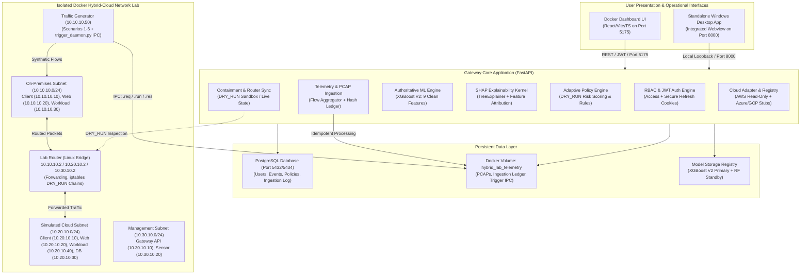

# FINAL SYSTEM ARCHITECTURE
## Adaptive AI-Powered Security Gateway for Hybrid Cloud

**Document Status:** FROZEN ACADEMIC ARCHITECTURE SPECIFICATION  
**Release Target:** Phase 22.8.5 / Phase 22.9  
**Execution Timestamp:** 2026-11-17T01:34:00+05:30

---

## 1. High-Level Architectural Overview

The **Adaptive AI-Powered Security Gateway** provides a unified perimeter protection layer for hybrid environments combining on-premises subnets and public cloud virtual networks. It incorporates machine-learning-driven threat detection, explainable AI (SHAP), automated policy generation, and multi-cloud telemetry ingestion into a single, cohesive security operations platform.

---

## 2. Core Subsystems & Components

### 2.1 Presentation Layer (Frontend)
- **Framework:** React 19 with TypeScript, bundled using Vite v8.3.5.
- **Styling & UI:** Tailwind CSS with Lucide icons and customized high-contrast security themes.
- **Views:**
  - `SimulationView.tsx`: Attack Simulation Control Center (Scenario cards, trigger controls, status polling).
  - `EventsView.tsx`: Real-time and persisted security event tables, severity badges, and flow detail modals.
  - `TrafficView.tsx`: Live network flow visualization, throughput counters, and risk meters.
  - `PoliciesView.tsx`: Generated firewall recommendations, rule review, and acceptance workflows.
  - `EvaluationView.tsx`: ML benchmark results, confusion matrices, and model comparison.
  - `AwsVpcView.tsx` & `MultiCloudView.tsx`: Multi-cloud resource inventory and VPC Flow Log inspection.
  - `SystemHealthView.tsx`: Node health, container status, and memory/CPU metrics.

### 2.2 Application Layer (FastAPI Backend)
- **Framework:** FastAPI with Uvicorn server, Pydantic v2 schemas, and SQLAlchemy 2.0 ORM.
- **Authentication & RBAC:**
  - Argon2/bcrypt password hashing with constant-time verification.
  - Short-lived asymmetric JWT access tokens with role claims (`ADMIN`, `OPERATOR`, `AUDITOR`).
  - HttpOnly, SameSite=Lax refresh cookies with persistent database revocation tokens.
  - Machine-to-Machine (M2M) service tokens for sensor-to-gateway telemetry ingestion.
- **Security Middleware:**
  - Content Security Policy (CSP), HSTS, X-Content-Type-Options, X-Frame-Options headers.
  - Sliding-window in-memory IP rate limiter protecting authentication endpoints.
  - Trusted management network filtering (`127.0.0.1/32`, `::1/128`, `10.30.10.0/24`).

### 2.3 Machine Learning & Explainability Engine
- **Primary Model:** Big Data XGBoost V2 (`candidate_xgboost_v2`):
  - Architecture: Gradient-boosted decision trees (`XGBClassifier`) trained on 6.49 million multi-dataset network flow records (CIC-IDS2017, UNSW-NB15, CSE-CIC-IDS2018).
  - Schema Version: Clean v2 schema featuring **exactly nine features** without synthetic artifacts:
    1. `packet_count`: Total bidirectional packets in flow.
    2. `byte_count`: Total bidirectional volume in bytes.
    3. `duration`: Flow duration in seconds.
    4. `conn_rate`: Connection pacing frequency (connections/sec).
    5. `dst_port`: Destination TCP/UDP service port.
    6. `unique_dst_ports`: Port diversity metric across connection session.
    7. `bytes_per_sec`: Throughput density.
    8. `packets_per_sec`: Packet arrival frequency.
    9. `avg_packet_size`: Mean payload size per packet.
  - Classes: `BENIGN`, `PORT_SCAN`, `TRAFFIC_SPIKE`, `SUSPICIOUS_TRANSFER`, `BRUTE_FORCE`.
- **Standby Rollback Model:** Production Random Forest (`production_rf`):
  - 100-estimator ensemble baseline retained for instant zero-downtime rollback in case of runtime anomaly.
- **Explainability:**
  - SHAP (`shap.TreeExplainer`) provides exact Shapley contribution values for each feature per prediction, attributing high-risk verdicts to specific flow anomalies (e.g., port scan identified by elevated `unique_dst_ports`).

### 2.4 Telemetry Ingestion & Idempotency Pipeline
- **Flow Aggregator:** Scapy-based bidirectional session reconstruction with inactivity timers (10.0s) and maximum duration limits (30.0s).
- **Persistent Ingestion Ledger:**
  - Stored in `/var/lib/hybrid-lab/telemetry/metadata/pcap_ingestion_ledger.json`.
  - Content hash tracking: Each PCAP file is digested with SHA-256 before processing.
  - Exact match skips: Files with identical hashes are skipped on sensor startup (`ALREADY_COMPLETED_IDENTICAL_HASH`).
  - Versioning: Modified files with distinct content hashes are ingested as new versions.
- **Database Idempotency:**
  - Unique constraint on security event IDs (`hash(src_ip, dst_ip, src_port, dst_port, protocol, timestamp_iso)`), preventing duplicate event rows.

### 2.5 Attack Simulation & IPC Trigger Framework
- **Isolated File-Based IPC:** The gateway API (user `gateway`, UID 10001) communicates with the traffic generator daemon via the shared volume directory `/var/lib/hybrid-lab/telemetry/triggers`:
  - Request: Gateway atomically drops `{run_id}.req`.
  - Acknowledgment: `trigger_daemon.py` detects `.req`, removes it, and writes `{run_id}.run`.
  - Execution: Daemon spawns the requested scenario script in the container network namespace.
  - Completion: Daemon captures stdout/metrics and writes `{run_id}.res`.
  - Polling & Grace: Gateway polls for `.res` using scenario-specific timeouts with a 2.0-second active grace window and pre-execution orphan reconciliation sweeps.
  - Heartbeat: Daemon maintains `.daemon_heartbeat.json` every 5 seconds.

---

## 3. Network Topology Specifications

The Docker hybrid lab emulates a realistic enterprise infrastructure across four isolated Docker bridge networks connected by a central Linux router:

| Subnet Name | Network CIDR | Primary Role | Key Nodes & IP Addresses |
|---|---|---|---|
| `onprem_net` | `10.10.10.0/24` | Enterprise On-Premises Office | `onprem-client` (10.10.10.10) `onprem-web` (10.10.10.20) `onprem-workload` (10.10.10.30) `traffic-generator` (10.10.10.50) |
| `cloud_net` | `10.20.10.0/24` | AWS/Cloud VPC Subnet | `cloud-client` (10.20.10.10) `cloud-web` (10.20.10.20) `cloud-db` (10.20.10.30) `cloud-workload` (10.20.10.40) |
| `mgmt_net` | `10.30.10.0/24` | Out-of-Band Management | `gateway-api` (10.30.10.10) `telemetry-sensor` (10.30.10.20) |
| `lab-router` | Multi-homed | Central Gateway & Perimeter Firewall | `10.10.10.2` (onprem) `10.20.10.2` (cloud) `10.30.10.2` (mgmt) |

---

## 4. Multi-Cloud Abstraction Architecture

The cloud integration subsystem provides a modular provider architecture:
- **AWS Provider (`backend/app/cloud/adapters/aws`):**
  - Read-Only IAM authentication via AWS STS and AssumeRole.
  - Automated resource discovery for EC2 instances, VPC security groups, Network ACLs, and subnets.
  - VPC Flow Logs parser normalizing AWS v2 flow log formats into unified flow records.
- **Azure & GCP Providers (`adapters/azure`, `adapters/gcp`):**
  - Normalized abstract interfaces (`CloudProviderAdapter`, `TelemetryClient`, `IdentityFederator`).
  - Extensible stubs ensuring architectural parity without requiring live billing credentials.
- **Multi-Cloud Registry:** Consolidates multi-cloud accounts and monitors read-only synchronization status.

---

## 5. Deployment Modes

1. **Docker Hybrid-Lab Mode (Full Lab Environment):**
   - Compose definition: `deployment/hybrid-lab/compose.yaml`.
   - Complete 13-container microservice fleet.
   - Live network routing, PCAP sniffing, and scenario generation.
   - Frontend served on `http://localhost:5175`, API on `http://localhost:8001`.
2. **Standalone Windows Executable Mode (Portable Evaluation):**
   - Executable: `AdaptiveSecurityGateway.exe` (37.42 MB single binary).
   - Embedded FastAPI server, bundled static frontend (`dist/`), and embedded ML models.
   - Local database connection to PostgreSQL (port 5434).
   - Served on `http://localhost:8000`.
